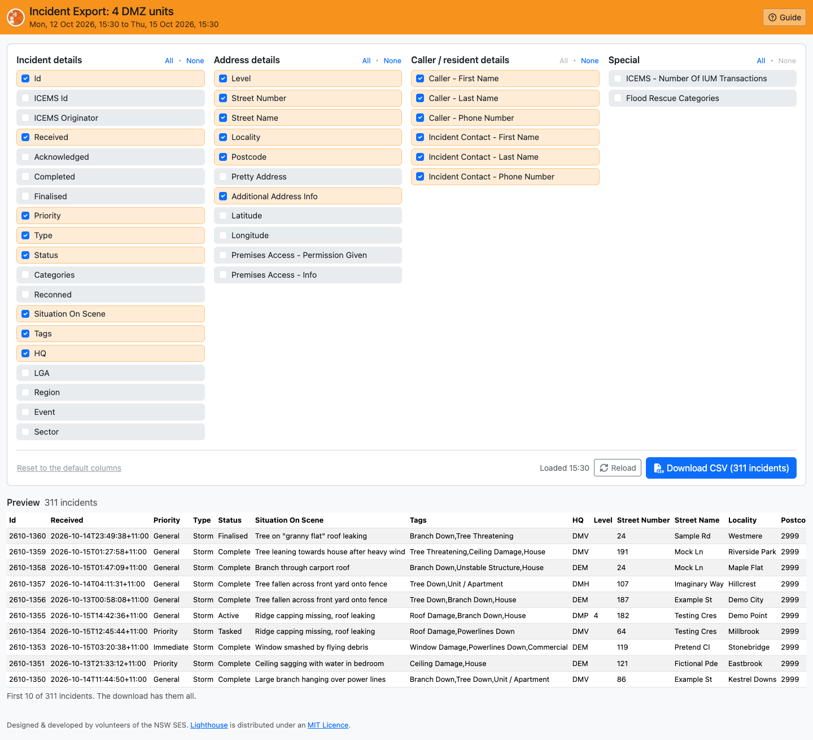
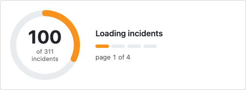
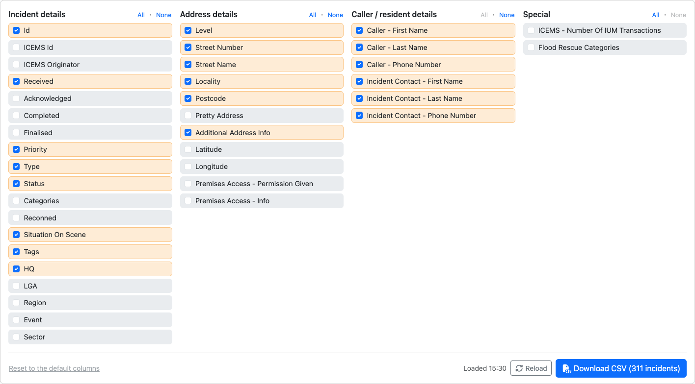
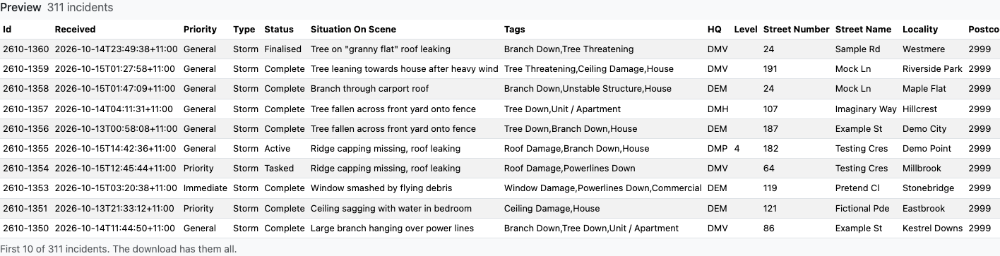
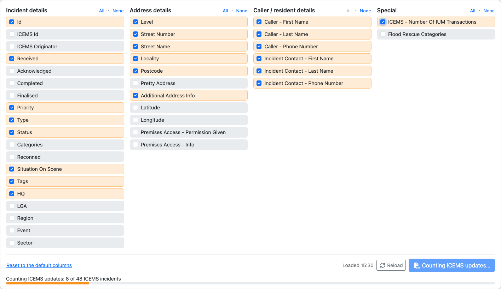
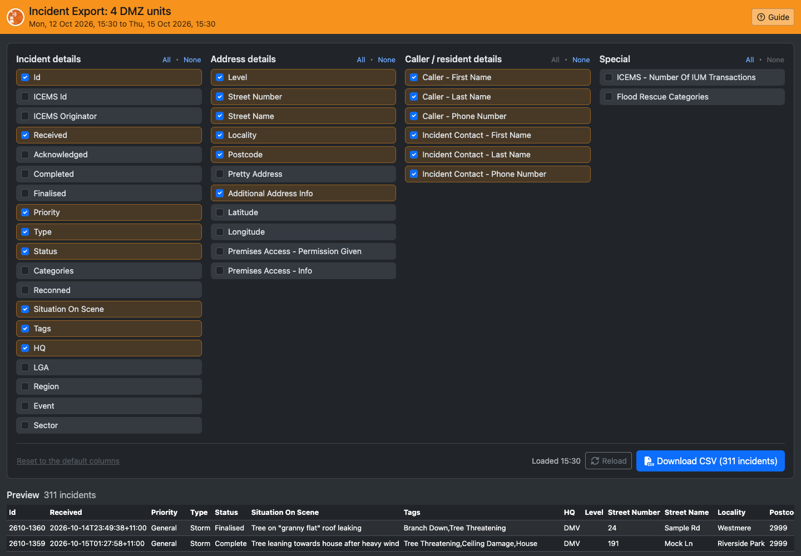

# Incident Export

Incident Export downloads an HQ's incidents as a CSV file you can open in Excel or Google Sheets. You pick the columns, check the first few rows in a preview, and download every incident in the range.

> **Note:** Screenshots showing "Demo City" use made-up data.

## Opening Incident Export

- **From the Lighthouse menu in Beacon:** choose **Incident Export (*your HQ* Today)**. This opens today's incidents for the HQ you're logged in to.
- **From Beacon's Jobs screen:** filter the incident list as you want it (HQs and dates), then click **Advanced Export (Filtered)** above the list. Incident Export opens with the same HQs and date range.

If no HQ is selected, the export covers all of NSW. The header names the HQs and shows the date range. It's coloured by the Beacon the page was opened from, as in LAD: orange for Beacon, green for Train Beacon and blue for Dev Beacon.

## Loading

The page loads the incidents as soon as it opens. Beacon sends them 100 at a time, so a ring counts them as they arrive, with the page it's on and the time left. If Beacon hasn't answered after 10 seconds, the page says it's still waiting.

If Beacon can't be reached, a message says why, with a **Try again** button. A *401* error means your Beacon login has expired: open Incident Export from Beacon again.

**Reload** (next to Download) loads the incidents again, for example to pick up ones that came in since you opened the page. If a reload fails, the incidents you already have stay, and a message says the export is from the last load.

## Choosing Columns

Tick the columns you want, in four groups:

| Group | Columns |
| --- | --- |
| **Incident details** | Id, ICEMS Id and Originator, Received, Acknowledged, Completed, Finalised, Priority, Type, Status, Categories, Reconned, Situation On Scene, Tags, HQ, LGA, Region, Event, Sector |
| **Address details** | Level, Street Number, Street Name, Locality, Postcode, Pretty Address, Additional Address Info, Latitude, Longitude, Premises Access |
| **Caller / resident details** | The caller's and incident contact's name and phone number |
| **Special** | ICEMS - Number Of IUM Transactions, Flood Rescue Categories |

- **All** and **None** beside each group tick or clear the whole group.
- Your choice is remembered for next time. **Reset to the default columns** goes back to the usual set.
- The columns are always in the order the page lists them.

## Preview

Under the columns, the preview shows the first 10 incidents with the columns you've ticked, newest first. It changes as you tick and untick columns. The download has every incident, not just these 10.

## Downloading

Click **Download CSV**. The file is named after the HQs and the time, e.g. *Incident export - Demo City - 2026-10-15 1530.csv*.

- **Times** are in ISO 8601 format with the offset from UTC, e.g. *2026-10-15T09:41:00+11:00*: NSW time, with +11:00 in daylight saving and +10:00 outside it.
- **Acknowledged** is when the incident first went Active. **Completed** and **Finalised** are the last time it reached that status, so an incident that was reopened shows when it was closed again.
- **Tags** and **Categories** are listed with commas between them.
- A line break in a field (often in Situation On Scene) becomes a space, so each incident stays on one row.
- The first row has the column names Beacon uses (e.g. *JobReceived*, *Address.Street*), as the old export did, so spreadsheets built on it still work.

## ICEMS Update Counts

**ICEMS - Number Of IUM Transactions** counts how many ICEMS Incident Update Messages each incident received from the agency that sent it. Only incidents that came in through ICEMS have a count; the rest are left empty.

The count comes from each incident's Ops Log, so ticking the column reads one Ops Log per ICEMS incident. A bar shows how far it has got, and **Download** waits until it's done. If an Ops Log can't be read, that incident's count is left empty and a note says how many were missed.

## Dark Mode

The page follows your computer's light or dark mode.

