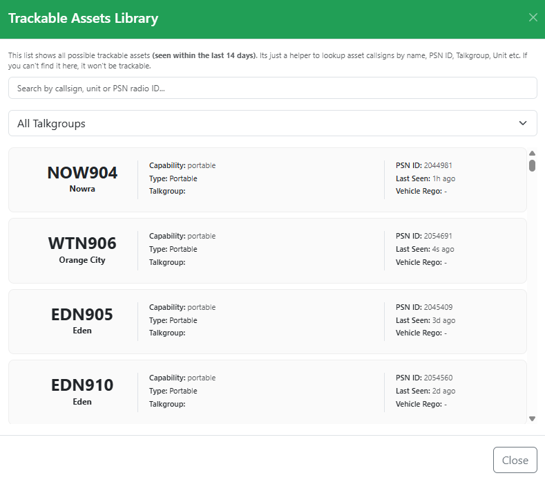
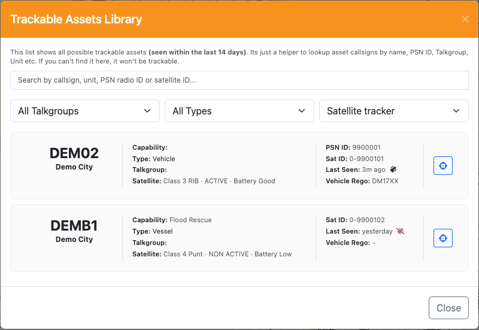
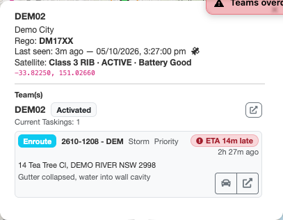
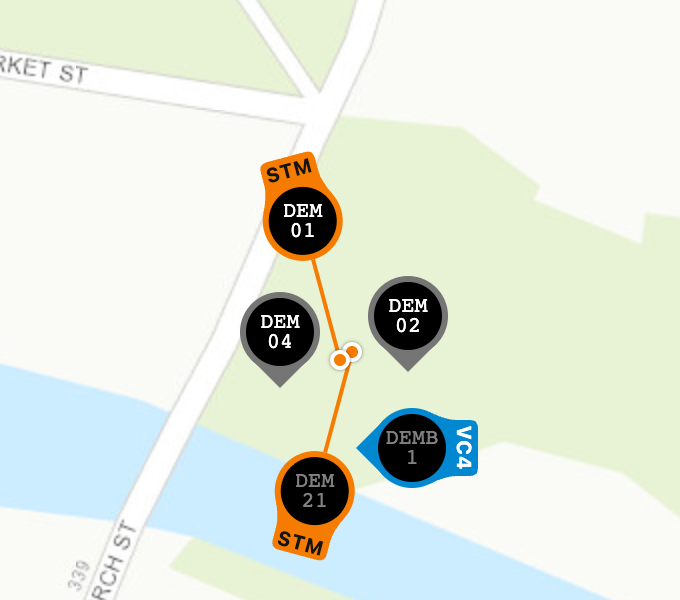
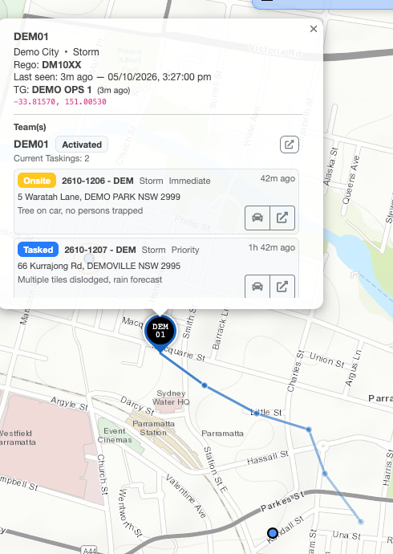

# Assets & Radio Tracking

LAD shows where teams are using the position reported by the **assets** matched to them: the GPS in an SES-issued PSN radio, or a satellite tracker fitted to a vehicle or vessel. Personal phones and non-SES radios aren't tracked.

Assets are matched to teams by the Beacon team name. A team with a matched asset is shown on the [Situation Map](situation-map.md), can be focused from the registers, and gets [Instant Task suggestions](tasking.md#instant-task-suggestions) based on its distance to an incident.

## Setting up a Team for Radio Tracking

LAD uses the Beacon **team name** to work out which radio to track. Where a callsign in a team name is an exact or close match to a PSN radio name, that radio is tracked against the team. Radio names can be looked up in the [Trackable Assets Library](#trackable-assets-library).

**Key points:**

- Radios are matched to teams by their **PSN Radio Name**.
- Each team has a **primary matched asset**, used for location-based features like tasking suggestions.
  - It is shown in the [expanded Team Register](team-register.md#matched-assets) as the matched asset with a star against it. It can be changed by the user and is synced to all LAD browsers.
- A team can have multiple radios. Include each callsign in the team name.
  - e.g. `PAR56 + PAR913` tracks both radios against the team (if they exist and match the PSN radio name).
- Exact matches take priority.
  - If the PSN radio name is `PAR56` and the team name includes `PAR56`, it is an **exact match**.
- With no exact match, the closest radio name is used.
  - If the PSN radio name is `PAR32` and the team name includes `PAR 32`, it matches as the **closest match**.
  - If the team name is `PAR3`, it matches the closest radio name, which could be `PAR31`, `PAR32` or `PAR33`.
- Each callsign in a team name can only be matched once.
  - If the team name includes `PAR3` and the closest match is `PAR31`, only `PAR31` is tracked.
- Team names can still contain other text, but any text that is similar enough to a radio name will match.
  - e.g. `PAR56 + PAR741 – Day Shift 2 IWO` works.

**Examples:**

- `PAR-56 + PAR741` matches the PAR56 vehicle radio and PAR741's boat radio. `PAR56 & PAR741` and `PAR56 Response with vessel PAR741` also work.
- `Parramatta 56 + Parramatta 741` will **not** match, as there is no PSN radio named like `Parramatta 56` or `Parramatta 741`.

### Unmatched Teams

Teams not linked to a radio asset show a location marker with a cross through it , and their focus button is greyed out. They aren't shown on the map.

### Troubleshooting Radio Matching

**Initial checks:**

- Confirm the team is **Activated** in Beacon.
- Confirm the team appears in the LAD Team Register.
- Confirm the name of the radio the team should match in the [Trackable Assets Library](#trackable-assets-library).
- Confirm the radio is turned on.

**Incorrect or non-standard radio names:** Some radios have names that don't follow the statewide format. In the **Layers** menu, under **Assets**, enable **Unmatched against Teams**. This shows all recently active radios so you can confirm the radio's name and update the team name to suit. You can also search the Trackable Assets Library, or use the Spotlight [`find` command](spotlight.md#find-asset-command--find).

**Radios not reporting location:** If a radio isn't checking in or updating its GPS location, contact the Service Desk. As a temporary fix for vehicle radios, the team can turn on a portable radio and you can add the portable's name to the team name so it is tracked instead. Make sure the portable stays on even when in the vehicle (the volume can be turned all the way down).

## Trackable Assets Library

The Trackable Assets Library lists every SES asset that has reported a location in the last 14 days, from PSN radios and satellite trackers. Use it to confirm an asset's details. Most commonly, that's finding the programmed radio name (for [team tracking](#setting-up-a-team-for-radio-tracking)) by searching for the PSN ID.

Open it from the filter dropdown in the Team Register, or from the **Trackable Asset Library** link at the bottom of the [Configuration](configuration.md) tabs. The Configuration link saves and closes Configuration first, the same as **Close**.

Each entry displays:

- Asset callsign (the name programmed into the radio)
- Assigned HQ
- Capability
- Type
- Current talkgroup
- PSN radio ID
- Time last seen
- Vehicle registration (where applicable)
- For assets with a satellite tracker: the satellite ID, and a **Satellite** line with the tracker's class, status and battery. Hover over the satellite ID to see the tracker's equipment ID.

### Searching and Filtering

Search by callsign, unit or zone name, PSN ID, satellite ID or satellite equipment ID using the field at the top. The dropdowns below it narrow the list by **Talkgroup**, **Type** (e.g. Vehicle or Vessel), **Capability** (as shown on the map, with its marker code, e.g. Heavy Rescue (HRV); every vessel is under Vessel) and **Source**, which is where the asset's location comes from: a **Satellite tracker**, or **PSN radio only** (no satellite tracker).

### Satellite-Tracked Assets

If an asset's location comes from a satellite tracker, a satellite icon  shows next to the time it was last seen. The icon is crossed out  if the tracker's status isn't **ACTIVE**, and its last reported location may be out of date.

On the map, a vessel with a class shows it in its [capability code](#capability-codes): **VC3** is a Class 3 vessel. A vessel whose class isn't known shows **VES**.

### Showing an Asset on the Map

Click the **Show on map** button  on an entry to close the library, focus the Situation Map on that asset and open its popup. LAD turns on the asset layer it needs if it's off (see [Asset Layers](#asset-layers)). The button is greyed out for assets without a location.

## Assets on the Map

### Asset Layers

Assets are shown on two layers, under **Assets** in the map's **Layers** menu (see [Overlays](situation-map.md#overlays)):

- **Matched against Teams**: radios and satellite trackers matched to a team in the Team Register. Only those that have reported a location in the last 24 hours are shown.
- **Unmatched against Teams**: radios and satellite trackers not matched to a team, shown with grey text. Icons are faded if the asset hasn't reported in the last hour.
  - This layer can slow LAD down, so turn it off again when you've finished with it.

The register *focus* buttons can only zoom to teams that are on the map.

### Asset Popup

Click an asset marker to see the radio or satellite tracker's details, such as when it was last seen, the team it's matched to, and that team's taskings. If the location comes from a satellite tracker, a satellite icon shows next to the last-seen time (crossed out if the tracker isn't active), with a **Satellite** line giving the tracker's class, status and battery (see [Satellite-Tracked Assets](#satellite-tracked-assets)). Each tasking has two buttons:

- **Route to Asset** (left): shows a road route from the team's current location to the incident with an approximate ETA.
- **Open Incident in Remote Tab**: opens the incident in the Beacon [remote tab](getting-started.md#remote-beacon-tab).

### Capability Codes

A tab on top of each asset marker shows the asset's capability as a short code, so capabilities with similar colours can be told apart, such as the rescue tiers and Community First Responder. The map [legend](situation-map.md#legend) lists each code next to its marker colour. The codes can be turned off under [Capability Codes](configuration.md#capability-codes) in Configuration.

| Code | Capability | Code | Capability |
| --- | --- | --- | --- |
| BUS | Bus | HRV | Heavy Rescue |
| CMD | Command | GLR | General Land Rescue |
| CCV | Corporate Command | SHQ | SHQ Pool / Pool Vehicle |
| CFR | Community First Responder | VES | Vessel (class not known) |
| GPV | General Purpose | PRT | Portable |
| LOG | Logistics | HCV | High Clearance |
| STM | Storm | SUP | Support |
| LSV | Light Storm | COW | Cell on Wheels |
| MSV | Medium Storm | SAV | Strategic Asset |
| LRV | Light Rescue | VC1–VC4 | Vessel, Class 1–4 |
| MRV | Medium Rescue | | |

Assets with any other capability, or none, have a grey marker and no code.

### Overlapping Asset Markers

When you're zoomed in to street level (zoom 15 by default), asset markers that would otherwise sit on top of each other spread out so every vehicle can be seen and clicked:

- **Swing around.** A marker that's in the way swings around its vehicle's position. Its point still sits exactly on where the vehicle is.
- **Move out on a line.** Where there isn't room to swing around, such as a yard with several vehicles parked together, the marker moves out to a clear spot. It becomes a circle, with a line back to a small dot where the vehicle is. Lines don't cross each other, and avoid running over other markers and dots.

- Hover over a marker to bring it to the front and highlight it, along with its line and dot.
- While a vehicle's popup is open, from clicking its marker or using **Show on map**, its marker stays on top and highlighted, and the popup opens over the marker wherever it has moved to.
- As vehicles move, markers slide smoothly out of each other's way, and markers that aren't moving hold their places.
- Zoomed further out, markers overlap as normal. Zoom in to separate them.

This can be turned off, and the zoom level and lines changed, under [Overlapping Markers](configuration.md#overlapping-markers) in Configuration.

### Asset Breadcrumb Trails

While a vehicle's popup is open, from clicking its marker or using **Show on map**, a breadcrumb trail shows where it has recently been. The trail is a line through its last reported positions in the marker's colour, with a dot at each position. It fades the older it gets, so you can see which way the vehicle came and roughly when.

- The trail covers the last **30 minutes** by default. Older positions drop off as they fade.
- Vehicles report their position every few minutes, so the line joins one report to the next in a straight line. It shows the direction and rough path of travel, not the exact roads taken.
- Positions are recorded for every vehicle while LAD is open, so selecting any vehicle shows its recent travel. Trails only go back to when LAD was opened, and they're kept only in your browser.
- A vehicle that stays put has no trail. When it moves again, the trail starts from where it was parked.

The trail can be turned off, and its length changed, under [Recent Travel](configuration.md#recent-travel) in Configuration.
