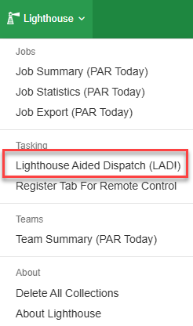
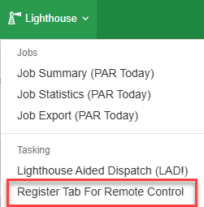
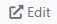
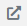
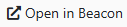
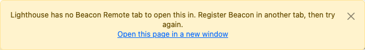

# Getting Started

## Launching LAD

To launch LAD, open the **Lighthouse** navigation menu in Beacon and select **Lighthouse Aided Dispatch (LAD!)**. LAD opens in a new browser tab.

## First-Time Setup

When you first launch LAD you are taken to the [Configuration](configuration.md) screen. Most settings can be left at their defaults. To get started:

1. On the **Data** tab, add the headquarters you're working for under [Headquarter Filters](configuration.md#headquarter-filters). With none selected, LAD loads data for **all** headquarters.
2. Optionally, on the **Filters** tab, narrow the [incident and team filters](configuration.md#filter-settings), e.g. to flood rescues only.
3. Click **Close** to save and open LAD.

You can re-open Configuration at any time with the **Page Configuration** button in either register. To give another operator the same setup, use [Share](configuration.md#sharing-configurations).

Next, [register a remote Beacon tab](#remote-beacon-tab), and check that your teams' names [match their radios](assets.md#setting-up-a-team-for-radio-tracking) so they show on the map.

## Remote Beacon Tab

LAD does not contain every Beacon function, so you will still need Beacon for some tasks. The remote tab feature tells LAD which Beacon tab to open incidents and teams in, so you can choose the tab, browser window or screen that Beacon opens on.

### Setting the Remote Tab

Open Beacon in a new tab. Under the **Lighthouse** navigation menu, click **Register Tab For Remote Control**. That tab is now the remote tab for LAD.

This works in split screen, a different browser tab or a different browser window. It must, however, be the **same browser application** that LAD is open in. You cannot set the remote tab in Edge if LAD is open in Chrome (and vice versa).

### Opening pages in the Remote Tab

Buttons throughout LAD open the selected item in the full Beacon page, in the remote tab. These are identified by the *Open in remote tab* icons:

  

When you click an *Open in remote tab* button, the incident or team opens in the remote tab you set previously.

If LAD can't use a remote tab, it shows a warning explaining why, with an **Open this page in a new window** link so you can still get to the page. This happens when:

- no remote tab has been registered,
- the remote tab has since been closed, or
- the tab LAD is open in is itself registered as the remote tab.

The warning stays until you close it or click the link. To go back to opening pages in a remote tab, [set the remote tab](#setting-the-remote-tab) again.
