# Incident Register

The Incident Register is in the bottom left of LAD. It lists all filtered incidents. Each row displays:

- **+** / **−**: shows whether the incident is [expanded](#expanded-incident-details). It's also the handle for [dragging the incident onto a team](tasking.md#drag--drop-team-tasking) to task it.
- **Star**: [stars](interface.md#starring-incidents-and-teams) the incident.
- Incident ID, with up to three icons underneath:
  -  **Photos**: photos have been uploaded to the incident. Click to open the [photo library](#incident-photos).
  -  **Outstanding actions**: the incident has outstanding *action required* tags. If there's more than one, the number beside the thumbtack shows how many. Click to open the [Incident Timeline](#incident-timeline).
  -  **ICEMS**: the incident is linked to ICEMS; hover to see the ICEMS incident number. It turns red when there's an unacknowledged IUM. See [ICEMS](#icems).

  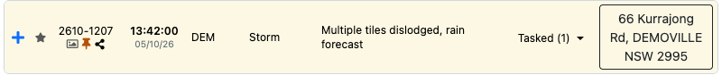
- Received (Recv) date and time
- Assigned HQ
- Incident type
  - Flood rescue incidents also show the flood rescue category 1–5, e.g. a *Critical Assistance* (category 1) flood rescue shows as `FR-1`.
  - Flood support incidents show the sub-type, e.g. *Medical Resupply*.
- Situation on scene, up to three lines
- Status
  - *Active* and *Tasked* incidents also show the number of taskings. This includes completed, called off and untasked teams, unless **Count active taskings only** is on under [Appearance](configuration.md#appearance).
  - If a team is on the way or on scene, its [ETA or ETC](tasking.md#arrival-and-completion-times) shows underneath.
  - Click the status to [change it](#changing-incident-status).
- Address
  - For geocoded incidents, click the address to focus the Situation Map on the incident. Double-click it to zoom in to street level.
  - Incidents with no GPS location show the address in italics and it can't be clicked; hover over it to see why. Incidents with neither an address nor a GPS location show *No location*.

Sort by Id, Recv, HQ, Type or Status by clicking the column heading; click again to swap between ascending and descending.

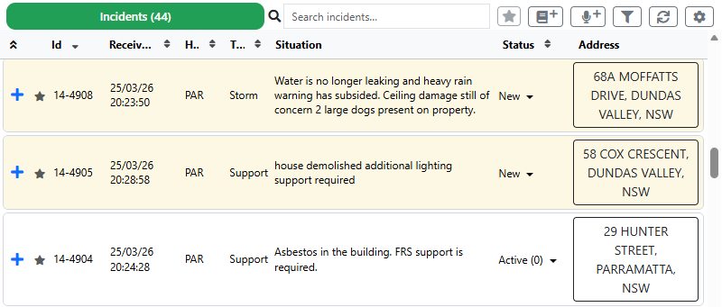

Each row's background colour shows the incident priority:

| Colour | Priority |
| --- | --- |
| White | General |
| Yellow | Priority |
| Blue | Immediate |
| Red | Rescue / life-threatening |

## Changing Incident Status

Click an incident's status to open a dropdown of status changes. Options that don't apply to the incident are greyed out. Opening the dropdown also refreshes the incident, so the options reflect its latest state.

- **Acknowledge**: for *New* (or *Rejected*) incidents.
- **Reopen**: for *Complete*, *Cancelled* or *Finalised* incidents.
- **Complete**: only once every tasking is complete, called off or untasked. Requires completion notes.
- **Reject**: for *New* or *Active* incidents. Requires a reason.
- **Cancel**: only once every tasking is complete, called off or untasked. Requires a reason.

Each change asks you to confirm before it's made in Beacon.

## Expanded Incident Details

Click anywhere on an incident row to expand it; click again to collapse it. Expanding an incident loads its latest details and taskings from Beacon. Clicking an incident on the map also expands it in the register. Everything in this section is only shown once an incident is expanded.

The expanded view shows:

- Incident tags
- Outstanding *Action Required* tags: any outstanding notes with action tags. Tags with the same name are grouped with a count, e.g. *Further Action Required ×2*. Click a tag to open the [Incident Timeline](#incident-timeline), where you can [resolve](#action-required-tags--resolving-notes) the notes.

  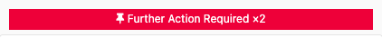
- Incident details, including the assigned sector
  - Click the current sector to choose a different one from a dropdown.
- Incident location details
- Contact details: the contact's name and number. If someone else made the call, a *Called By* line shows the caller's name and number; it's hidden when the caller is the contact.
- [Incident actions](#incident-actions)
- Taskings list: every team tasked to the incident, including teams outside your LAD team filters, and untasked, called off and completed teams. See [Incident Taskings Actions](#incident-taskings-actions).

To collapse every incident at once, use the **collapse all** button in the [register controls](interface.md#register-controls).

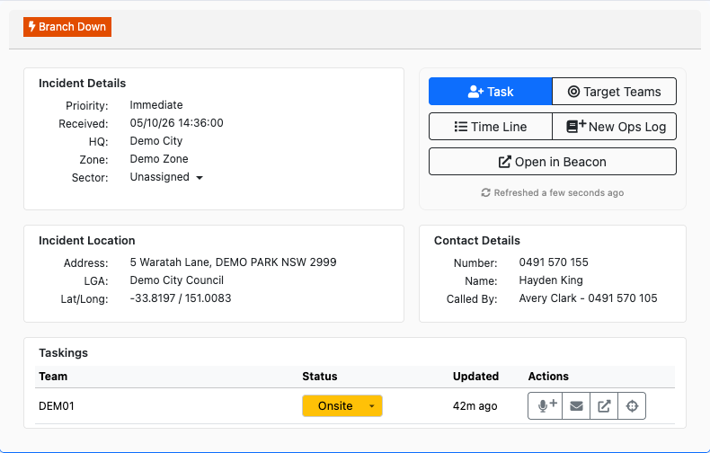

### Incident Actions

The expanded incident has five action buttons:

- **Task**: opens [Instant Task](tasking.md#instant-task). Greyed out for *Complete*, *Cancelled*, *Rejected* and *Finalised* incidents.
- **Target Teams**: finds the closest teams and shows their straight-line distance to the incident. See [Tasking Teams](tasking.md).
- **Time Line**: opens the [Incident Timeline](#incident-timeline).
- **New Ops Log**: opens [New Ops Log](logs-and-messages.md#new-ops-log).
- **Open in Beacon**: opens the incident in the Beacon [remote tab](getting-started.md#remote-beacon-tab).

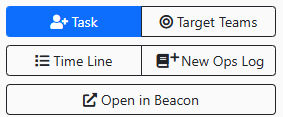

Under the buttons, **Refreshed** shows how long ago the incident's details were loaded. Click it to reload them.

### Incident Taskings Actions

Each team in the expanded incident's taskings list has the same four actions as in the Team Register:

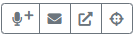

- **Radio Log** (against the incident): opens [New Radio Log](logs-and-messages.md#new-radio-log) with the incident and team filled in. You can also [change the team's status](logs-and-messages.md#changing-the-teams-status) when you submit.
- **Message Team** (against the incident): opens [Send SMS](logs-and-messages.md#send-sms) with the team members as recipients, associated with the incident.
- **Open in Remote Tab**: opens the team in the Beacon remote tab.
- **Focus on map**: focuses the Situation Map on the team's radio location, if matched.

Tasking statuses can be updated the same way as in the Team Register. See [Tasking Status](tasking.md#tasking-status).

## Incident Timeline

The Incident Timeline shows all ops log entries (notes), tasking status updates and incident status updates for the incident. It combines the *Notes* and *Incident Timeline* sections of the Beacon incident page.

It has three display modes:

- **Incident History**: incident status updates and tasking status updates.
- **Ops Log**: ops log entries (notes).
- **Both**: ops log entries and incident history together.

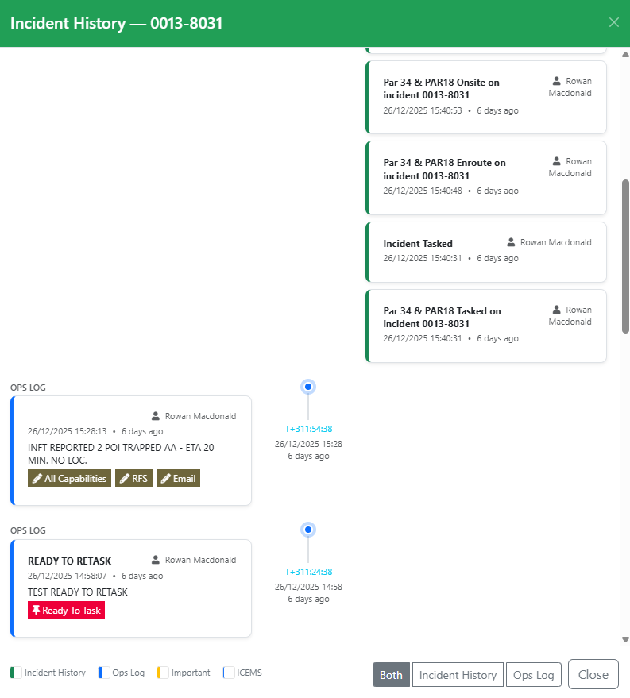

The timeline is sorted newest (top) to oldest (bottom). Entries are colour-coded to distinguish incident history, ops log entries, urgent ICEMS messages and non-urgent ICEMS messages.

Filter the ops log entries by selecting tags at the top of the timeline. This is an **AND** filter: entries are only shown when they contain **all** selected tags.

ICEMS messages are covered in [ICEMS](#icems).

### Action Required Tags & Resolving Notes

Notes with an outstanding *action required* tag show an **Action Required** label and a **Resolve** button.

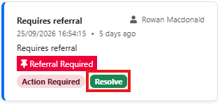

Click **Resolve**, enter the resolution notes (required) and click **Resolve** to resolve the note.

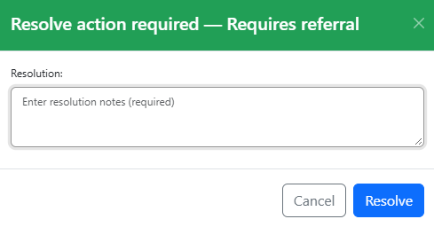

## ICEMS

> **Note:** ICEMS functionality in LAD is still in development and features are being added gradually. Confirm that actions taken within LAD work correctly.

Incidents linked to ICEMS show the ICEMS icon  under the incident ID. Hover over it to see the ICEMS incident number. ICEMS messages (IUMs) appear in the [Incident Timeline](#incident-timeline), and the agencies involved are listed when you [hover over the incident](situation-map.md#hovering-over-an-incident) on the map.

### Unacknowledged IUMs

When there is an unacknowledged ICEMS notification, LAD flags it in several places:

- **Alert**: an [alert](interface.md#alerts) is shown in the top right of the Situation Map whenever ICEMS notifications are present.

  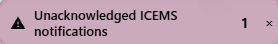

- **Incident Register**: the ICEMS icon turns red on any incident with an unacknowledged IUM, and a red banner is shown on the expanded incident. Click the banner to open the Incident Timeline. The same indicators appear in the incident popup on the Situation Map.

  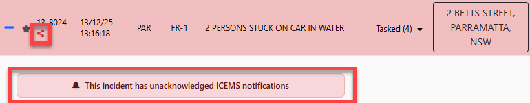

- **Incident Timeline**: a warning is shown at the top of the timeline for any unacknowledged IUMs.

  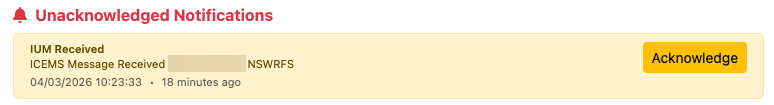

### Acknowledging an IUM

Click **Acknowledge** next to the unacknowledged IUM notification in the Incident Timeline.

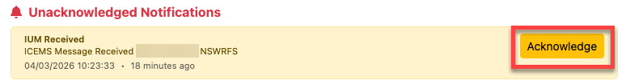

## Incident Photos

When photos have been uploaded to an incident, a photo icon  appears under the incident ID in the register. Click it to open the photo viewer for the incident.

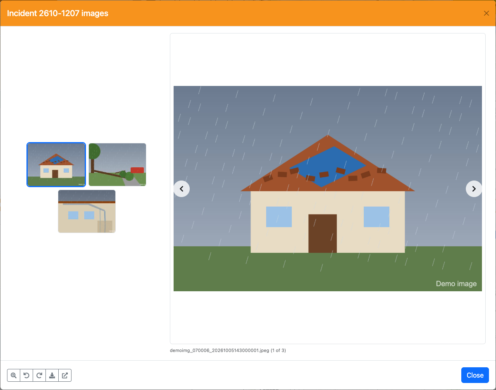

The viewer opens on the first photo, with thumbnails of all the incident's photos on the left and the selected photo on the right. The count under the photo shows which one you're on, e.g. *(1 of 3)*.

- **Change photo**: click a thumbnail, use the arrows either side of the photo, or press <kbd>←</kbd> / <kbd>→</kbd>.
- **Zoom**: click the photo, or the zoom button at the bottom left, to see it at actual size. While zoomed, drag the photo to pan around it. Click again to fit it back to the window.

  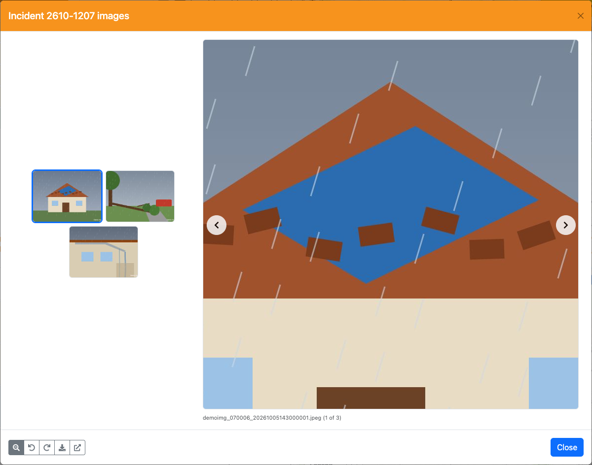

- **Rotate**: rotate the photo left or right, for photos taken sideways.
- **Download**: save the photo to your computer.
- **Open in new tab**: open the full-size photo in a new browser tab.
