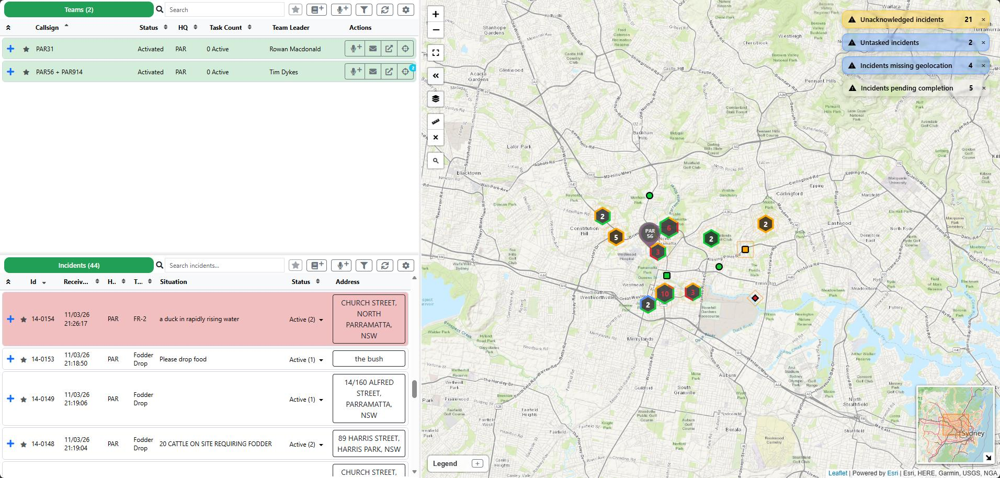
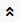
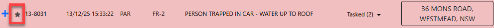
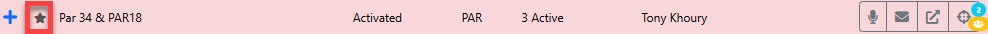
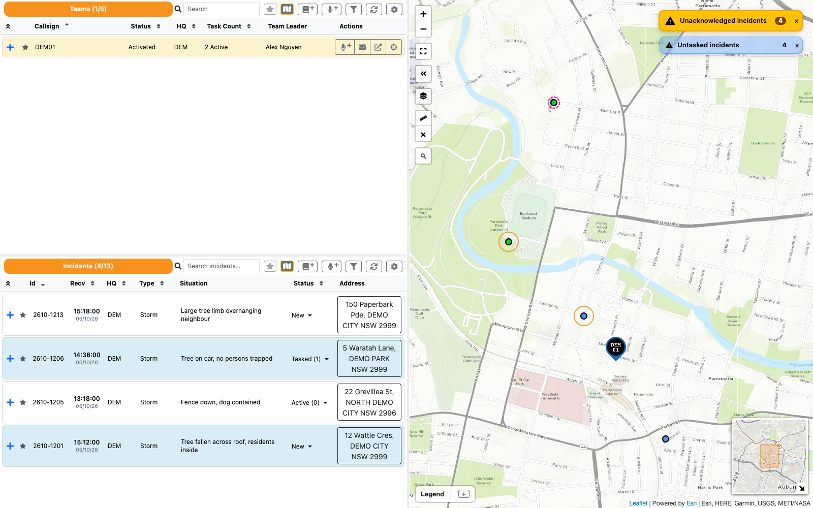
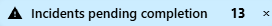
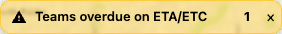
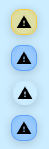
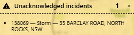

# Interface Overview

The LAD interface has two core components: the **side drawer** and the **situation map**. The divider between them can be resized, and the side drawer can be hidden completely for a full-screen map by clicking the **<<** button on the map. You can also choose a different arrangement under [Layout](configuration.md#layout).

**Side drawer**

- **Team Register** (top): lists all filtered teams and their taskings, with actions against those teams. See [Team Register](team-register.md).
- **Incident Register** (bottom): lists all filtered incidents and their details, with actions against those incidents. See [Incident Register](incident-register.md).

**Situation Map**

- Displays all filtered incidents and teams, and allows actions to be taken against them. Layers are available to display additional map information. See [Situation Map](situation-map.md).

## Register Controls

The Team and Incident registers share a common set of controls:

- **Toggle Starred**: switches the register between all filtered incidents/teams and only [starred](#starring-incidents-and-teams) ones.
- **Toggle In Map View**: lists only the incidents/teams inside the current Situation Map view. See [Listing Only What's in the Map View](#listing-only-whats-in-the-map-view).
- **New Ops Log Entry**: opens the [New Ops Log](logs-and-messages.md#new-ops-log) dialog. The entry is not automatically attached to an incident.
- **New Radio Log Entry**: opens the [New Radio Log](logs-and-messages.md#new-radio-log) dialog. The entry is not automatically attached to a team or incident.
- **Filter Settings**: opens the filters relevant to that register (Teams or Incidents).
  - The Team Register filter dropdown also opens the [Trackable Assets Library](assets.md#trackable-assets-library).
- **Refresh Data**: refreshes the data for that register. With [Live Updates](configuration.md#live-updates) on, it also flashes briefly whenever Beacon pushes a change for that register, so you can see updates arriving. Tasking changes flash both registers' buttons.
- **Page Configuration** (right): opens the [Configuration](configuration.md) screen.

Each register also has a **collapse all** button  that collapses every team or incident in that register.

## Starring Incidents and Teams

You can star incidents and teams in each register, then toggle the register between all filtered items (the default) and only starred items.

Star or un-star an item by clicking the star button on its row; a starred item's star appears larger.

Switch views with the **Toggle Starred** button in the [register controls](#register-controls). Clear starred items from the [Starred](configuration.md#starred-teams--incidents) configuration tab.

## Listing Only What's in the Map View

Each register can be narrowed to only the incidents or teams inside the current Situation Map view. This is useful when you're zoomed in on one area and want the registers to match what you can see on the map.

Click the **Toggle In Map View** button (map icon, next to **Toggle Starred**) in the register's controls. While it's on, the button is highlighted and the register heading shows how many items are listed out of all filtered items, e.g. **Incidents (4/13)**.

The list updates as you pan and zoom the map.

- An **incident** is in view when its address is inside the map view. Incidents without a geocoded location aren't listed while the toggle is on.
- A **team** is in view when any of its [matched radios or satellite trackers](team-register.md#matched-assets) is inside the map view. Teams without a matched radio or satellite tracker aren't listed while the toggle is on.

> **Note:** This only changes the register lists. The map still shows every filtered incident and team, and [alerts](#alerts) still count everything that matches your filters.

Each register's toggle is separate and works alongside **Toggle Starred** and the register search. LAD remembers the setting on this computer; **Restore Defaults** on the [Configuration](configuration.md#restoring-default-settings) screen turns it off.

## Alerts

Alerts display in the top right corner of LAD under certain conditions:

- **Unacknowledged Incidents**: all filtered incidents in the *New* status.

  

- **Untasked Incidents**: all filtered incidents in the *Active* status that have no taskings.

  

- **Unacknowledged ICEMS**: all filtered incidents with an unacknowledged ICEMS message. See [ICEMS](incident-register.md#icems).

  

- **Incidents Pending Completion**: incidents where all teams have completed but the incident is still active. This flags incidents that can potentially be closed if no further action is required.

  

- **Incidents missing geolocation**: incidents created without a geocoded (GPS) address. These are not displayed on the map.

  

- **Teams overdue on ETA/ETC**: teams 5 minutes or more past their ETA (while *Enroute*) or ETC (while *Onsite*). Click a team to jump to it in the Team Register. See [Arrival and Completion Times](tasking.md#arrival-and-completion-times).

  

### Managing Alerts

Minimise an alert by clicking the cross on its right. Minimised alerts show as small icons and can be re-opened at any time. Minimising does not dismiss the underlying alerts. An alert automatically re-appears if another incident meets its condition, e.g. a new unacknowledged ICEMS message.

To have alerts start minimised, turn on **Auto-collapse alert popups** under [Appearance](configuration.md#appearance).

### Selecting Alerts

Click the incident text in an alert to select that incident in the Incident Register and focus the Situation Map on it.

## Keyboard Shortcuts

LAD has several dialogs, such as New Radio Log, New Ops Log and the Incident Timeline. They share common hotkeys:

| Keys | Action |
| --- | --- |
| <kbd>Ctrl</kbd>/<kbd>Cmd</kbd> + <kbd>Enter</kbd> | Submit the dialog |
| <kbd>Esc</kbd> | Close the dialog |

Anywhere in LAD:

| Keys | Action |
| --- | --- |
| <kbd>Ctrl</kbd>/<kbd>Cmd</kbd> + <kbd>K</kbd> | Open the [Spotlight](spotlight.md) menu (can be changed under [Appearance](configuration.md#appearance)) |
| Hold <kbd>Space</kbd> | Temporarily hide all map popups (see [Hiding All Popups](situation-map.md#hiding-all-popups)) |
