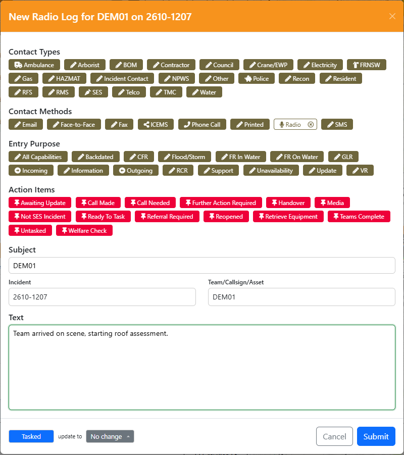
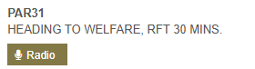
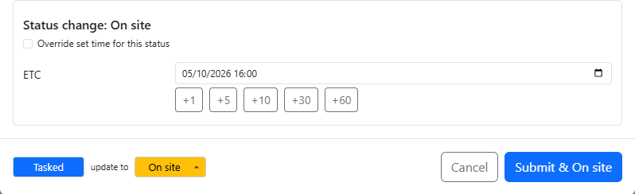
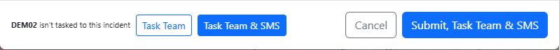
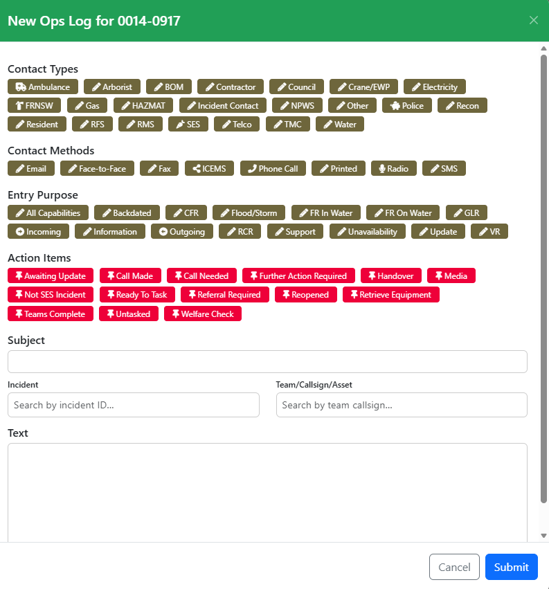
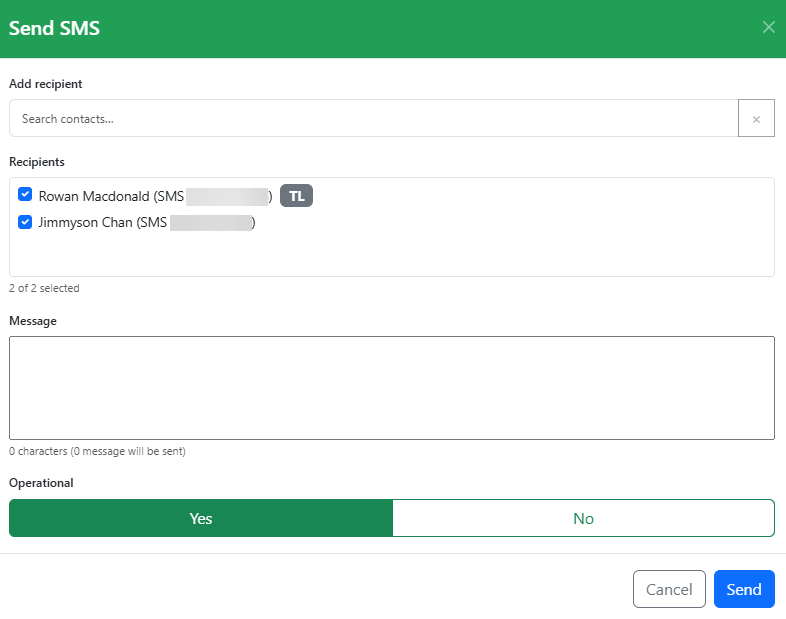
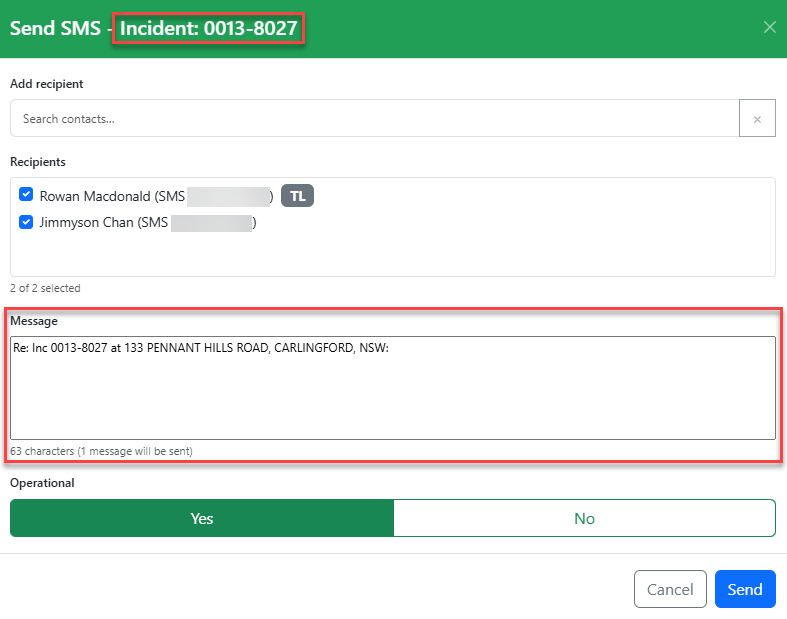
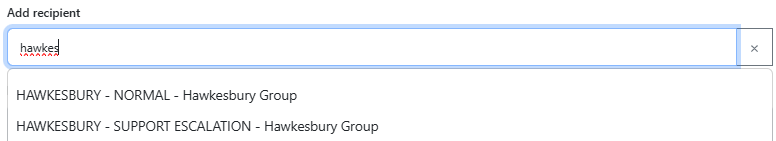

# Logs & Messages

LAD can create radio logs and ops log entries, and send SMS to team members, without opening Beacon. The buttons are on team rows and taskings in both registers, in the [register controls](interface.md#register-controls), and in incident popups on the map. The Spotlight [`radio`](spotlight.md#radio-log-command--radio) and [`log`](spotlight.md#ops-log-command--log) commands open the same dialogs from the keyboard.

## New Radio Log

Clicking a **Radio Log** button opens the New Radio Log dialog. It is the same dialog as [New Ops Log](#new-ops-log), with the *Radio* contact method already selected. The title shows the team's callsign, plus the incident ID if opened against an incident.

- Clicking Radio Log on a **tasking** (a team on an incident) fills in the **Incident** and **Team** fields, and the subject is the team's callsign. The log is created against that incident, and you can [change the team's status](#changing-the-teams-status) at the same time.
- Clicking Radio Log on a **team** fills in the **Team** field and the subject, but does not associate the log with an incident. If you pick an incident that the team is tasked to, you can change the team's status too.
- Clicking Radio Log in the [register controls](interface.md#register-controls) opens the dialog with nothing filled in.

Add any other tags you need, enter your message in **Text**, then click **Submit**. The entry is created with the tags you selected. If created against an incident, it is visible in that incident's *Notes* / *Ops Log Entries*.

The Spotlight [`radio`](spotlight.md#radio-log-command--radio) command opens the same dialog with the incident and team filled in, the same as clicking Radio Log on a tasking.

### Changing the Team's Status

When the **Incident** and **Team** fields point at a team that is tasked to that incident, the bottom of the dialog shows the team's current status for that incident, followed by **update to** and a status menu. This happens straight away when the dialog is opened from a tasking. It also happens when you fill the fields in yourself, for example after opening it from a team row or the register controls, and in the New Ops Log dialog:

- **Incident**: pick the incident from the suggestions. Typing the ID without picking it doesn't attach the log to the incident, so the status menu doesn't appear.
- **Team**: type the team's callsign, or pick a trackable asset that is matched to the team.

The menu starts at **No change** and lists the same statuses as [Tasking Status](tasking.md#tasking-status). Statuses the team can't change to from its current status are greyed out.

- Picking a status does not change anything straight away. The change is made when you click **Submit**, and the button shows the status, for example **Submit & On site**.
- If the status needs more information (a time, ETA, ETC or reason), a **Status change** box appears at the bottom of the dialog, and the dialog scrolls down to it. It works the same way as in the tasking status dropdown.
- **Complete** opens Beacon's *Team Completion* dialog in the remote tab after the log entry is saved.
- If you change the **Incident** or **Team** field, the status menu follows: it switches to that team's tasking on that incident, or is hidden if there isn't one. Any status you'd picked is cleared.

When you click **Submit**, LAD changes the status first and only saves the log entry if that worked:

- If the status change fails, the dialog shows why and stays open. Nothing is logged, so you can fix it or pick **No change** and submit again.
- If the team's status changed while the dialog was open (for example, someone else set it in Beacon) and the status you picked is no longer available, the dialog says so and nothing is submitted.
- If the status changes but the log entry fails to save, the dialog tells you. Submitting again only retries the log entry; the status is not sent twice.

### Tasking the Team from a Log

If the **Incident** and **Team** fields point at a team that isn't tasked to that incident (or whose tasking there is complete, called off or removed), the bottom of the dialog says so and offers two buttons instead of the status menu:

- **Task Team**: tasks the team to the incident when you click **Submit**.
- **Task Team & SMS**: tasks the team when you click **Submit**, then opens [Send SMS](#send-sms) addressed to the team, pre-filled with the incident details, once the dialog has closed. This is the same message as [Instant Task](tasking.md#tasking-the-team)'s **Task & SMS Details**.

Click a button again to unselect it. Nothing happens until you click **Submit**, and the button shows what will happen, for example **Submit, Task Team & SMS**. The team must be a known team: type its callsign or pick one of its trackable assets.

As with a status change, LAD tasks the team first and only saves the log entry if that worked. If tasking fails, the dialog shows why and nothing is logged. If the team is tasked but the log entry fails to save, submitting again only retries the log entry and doesn't task the team twice, and Send SMS still opens once it saves. If someone else tasks the team to the incident while the dialog is open, the dialog says so and the status menu is shown instead.

## New Ops Log

Clicking an **Ops Log** button opens the New Ops Log dialog. It works the same way as Beacon notes: select tags, enter a subject and text. If opened from an incident it is automatically attached to that incident. You can also enter a team to pre-fill the subject with the team's name.

You must select at least one tag and enter text before clicking **Submit**.

Ops log entries for an incident are shown in its [Incident Timeline](incident-register.md#incident-timeline).

## Send SMS

Clicking an **SMS** button opens the Send SMS dialog, listing every team member and their SMS number from their Beacon contact details.

Choose recipients with the checkbox next to each member, then click **Send**. Setting **Operational** to *Yes* marks it as an operational SMS in the Beacon message register.

### Sending SMS for an Incident

If you click Send SMS against a team tasked to an incident, the message is pre-filled with the incident ID and address. Messages sent against an incident also appear in that incident's *Messages* section.

**Task & SMS Details** in [Instant Task](tasking.md#tasking-the-team) opens the same dialog after tasking the team.

### Adding Additional Recipients

Add recipients by searching in the **Add recipient** field: individual members by name or member number, or contact groups by group name. The search covers all members and contact groups statewide.

