# Situation Map

The Situation Map is on the right of the screen (by default, see [Layout](configuration.md#layout)). It displays all filtered incidents and matched teams, giving you a visual picture to support tasking and decision making.

Map layers (incidents, assets, routes and each overlay) are stacked in order, with higher layers drawn over lower ones. By default incident markers are drawn on top and weather imagery at the bottom. You can change the order, and make any layer see-through, on the [Map layers](configuration.md#map-layers) tab of the Configuration screen.

## Map Control

### Zoom

Use the **+** and **−** buttons in the top left, or the mouse wheel.

### Panning

Click and hold the left or middle mouse button and drag.

### Minimap

The minimap in the bottom right shows the current view in context of the wider area, and can be dragged to move the map. Hide or expand it with the arrow in its bottom right corner.

### Hiding All Popups

Hold <kbd>Space</kbd> to temporarily hide all popups; release to bring them back.

### Measuring Tool

Measure distances between multiple points. Several separate measurements can be on the map at once.

1. Click the ruler icon on the left of the map.
2. Click two or more points. The distance between each pair of markers is shown in green, and the total in blue.

- <kbd>Shift</kbd> + click a marker to delete it.
- Press <kbd>Esc</kbd> to start a new set of markers.
- Click the ruler icon again, or press <kbd>Esc</kbd> twice, to turn the tool off.
- The **X** icon under the ruler clears all measurements.

## Layers

Layers control what is shown on the map. Open the Layers menu with the layer button  in the top left of the map.

The menu has a list of sections down the left: **Basemap**, **On the map** (every layer that's turned on), then each group of overlays. Click a section to show its layers. A number beside a group shows how many of its layers are on. The menu fits itself to the map and stops above the Legend. On a narrow map the sections become a row of buttons along the top.

### Basemap

The basemap is the underlying street or imagery map. The default is **Esri Topographic**; basemaps are available from Esri, Spatial NSW and SIX Maps, covering both street and satellite imagery.

How far you can zoom in depends on the basemap. The Esri basemaps go down to street level, and the Spatial NSW and SIX Maps basemaps one level further. Esri Dark has less detail, so at the closest zoom levels it shows its most detailed map enlarged, which looks blurry.

To change basemap, open the **Layers** menu, click **Basemap** at the top of the list and click a basemap's picture. The section shows the current basemap's name under **Basemap**.

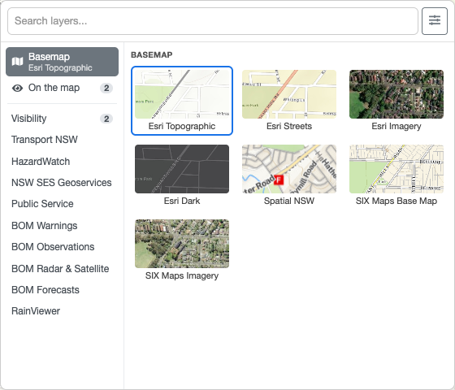

### Overlays

Overlays sit on top of the basemap to add information. Pick a group in the Layers menu and toggle its overlays on and off, or use the search bar at the top to find a layer in any group (or a basemap). Click **On the map** to see everything that's on and turn layers off. A layer you turn off stays in that list until you pick another section, so you can turn it back on. The  button next to the search bar opens the [Map layers](configuration.md#map-layers) settings, where you can move an overlay above or below other layers or make it see-through. Anything typed in the search bar is carried across.

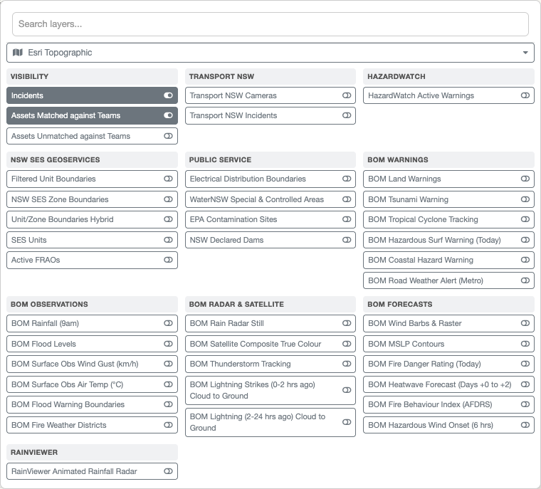

#### Overlay Loading Status

When you turn an overlay on, its row in the Layers menu shows how it's going:

- A **spinner** while it loads.
- A **green number** once it has loaded: how many items it put on the map. Overlays that are pictures, such as radar and satellite, show a tick instead. Hover over the row to see how many items are in your current view and when the overlay last updated.
- A **grey 0** and *Nothing to show right now* when the overlay loaded but has nothing to show, such as HazardWatch with no active warnings.
- **failed** and a red row when it couldn't load, with the reason. Click **Retry** to try again.
- **stale** when a later refresh failed. The overlay keeps showing what it last loaded, and the row says what time that was.
- An **amber** number or count of map tiles when only part of it loaded, for example when some radar tiles failed.

The Layers button  shows a small spinner while any overlay is loading, a green tick when they've all loaded, and a red number if any have failed or gone stale, so you can tell without opening the menu.

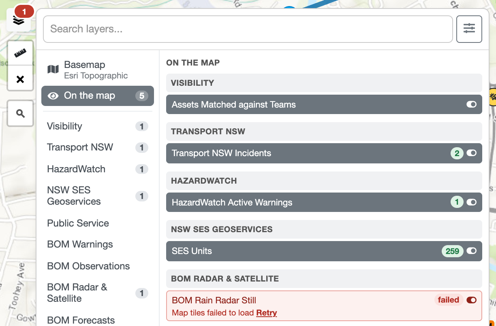

#### Clickable Overlay Markers

Some overlays drop their own markers on the map. Click one to open a popup with more detail.

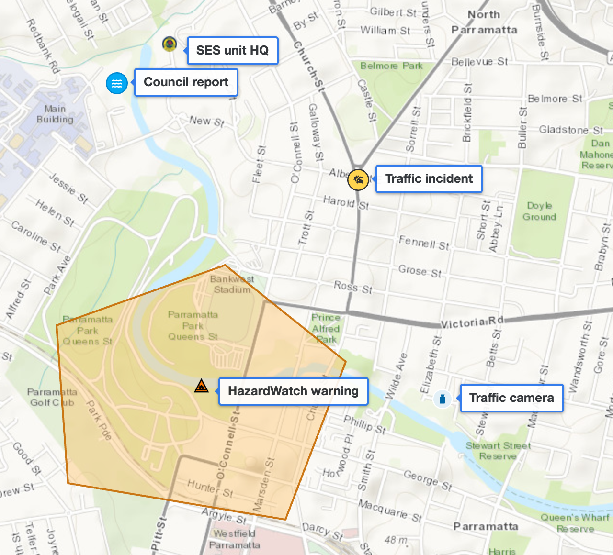

| Overlay | Marker | Click it to see |
| --- | --- | --- |
| **Transport NSW Incidents** | Live Traffic icon for the type of incident (crash, hazard, breakdown, traffic lights out, changed conditions, flooding, fire, bad weather, snow and ice) | What happened, where, traffic advice (with the speed limit when it's reduced), when it started and ends, who is attending and who reported it. Council reports are titled *Council Report* and show the council's name and contact details. Details the report doesn't include are left out |
| **Transport NSW Cameras** | Camera icon | What the camera faces and its latest image (click the image to enlarge it) |
| **HazardWatch Active Warnings** | Warning icon in the middle of each warning area | The full published warning. Clicking anywhere in the area also works |
| **SES Units** | SES logo at each unit headquarters | The unit's status (Monitoring, Not Monitoring or Unavailable), its active teams and incidents, SRB accreditations and contacts |
| **EPA Contamination Sites** | Red dot | Site name, address, activity type and management class |
| **NSW Declared Dams** | Blue dot | Dam name, place, owner and declared status |

**Transport NSW Incidents** shows both incidents managed by Transport NSW and road closures and hazards reported by local councils. Council reports are often regional road closures, such as flooded causeways, that don't appear as Transport NSW incidents. Council roadworks are left out. Where Transport NSW maps the affected stretch of road or area, it's drawn as a coloured line or shaded area, coloured as on Live Traffic NSW: blue for flooding and weather, dark red for fire and heavy impact, orange for moderate and grey for low impact. Click a line or area for the same details.

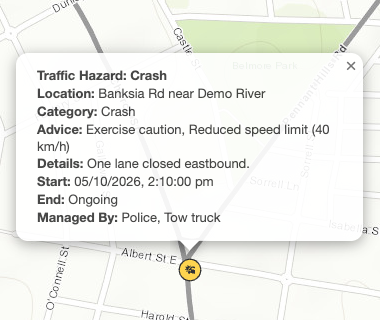

Some area overlays also open a popup when you click inside an area: **BOM Land Warnings** (warning type, severity and times) and **WaterNSW Special & Controlled Areas** (area name and class). Other overlays, such as boundaries, radar and BOM observations, are pictures only and don't respond to clicks.

Overlay markers are drawn under incidents by default. If one is hidden behind an incident, move it up on the [Map layers](configuration.md#map-layers) tab of the Configuration screen.

#### Overlay Notes

Most layers are described by their name. Those that need more explanation:

**Visibility**

- **Incidents**: shows or hides every incident marker, along with their [status indicators](#incident-status-on-markers). Focusing an incident from an [alert](interface.md#alerts), the Incident Register or [Spotlight](spotlight.md) turns the layer back on.

**Assets**

- **Matched against Teams** and **Unmatched against Teams**: radios and satellite trackers, split by whether they're matched to a team. See [Asset Layers](assets.md#asset-layers).

**NSW SES Geoservices**

- **Filtered Unit Boundaries**: a pink outline around your filtered headquarters.
- **NSW SES Zone Boundaries**: SES zone boundaries.
- **Unit/Zone Boundaries Hybrid**: SES zone and unit boundaries.
- **SES Units**: the location of every SES unit headquarters.
- **Active FRAOs**: active FRAO declarations, from the Beacon FRAO register.

**HazardWatch**

- **HazardWatch Active Warnings**: flood, tsunami, severe weather, coastal erosion and snow warnings. Click a warning to see the published product details. Refer to the Public Information Manual for more on warnings.

**RainViewer**

- **RainViewer Animated Rainfall Radar**: the last two hours of rainfall radar, played on a loop. While it's on, a small **Radar** bar sits above the [Legend](#legend) with play/pause, the time of the frame showing, and how far that frame is behind the latest one. Click **Radar** to open the step buttons, a slider to drag through the frames, the playback speed and the colour scale (hover over a colour to see its rain or hail level). Click the time badge, or **Latest**, to jump back to the newest frame. New frames are added every few minutes: if you've paused on an earlier frame it stays on that frame, and if you're on the latest it moves on to the new one. The bar remembers whether you left it open. To make the radar more or less see-through, use the [Map layers](configuration.md#map-layers) tab; it starts at 60%.

**Collaborative layers** you've subscribed to are also listed here. See [Collaborative Map Layers](#collaborative-map-layers).

## Legend

The legend is in the bottom left of the map and explains the icons shown: incident shapes and priority colours, flood rescue categories, job status indicators, overlays and asset types. Each asset type is listed with its marker colour and its [capability code](assets.md#capability-codes). It can be hidden and re-opened at any time.

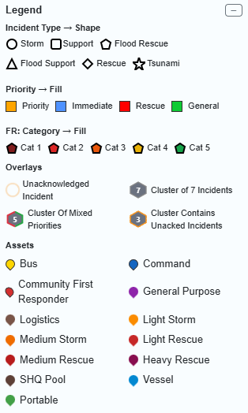

## Incidents on the Map

All filtered incidents are shown on the map, with shape and colour depending on incident type and priority (see the [Legend](#legend)). Incidents without a geocoded address aren't shown, and are listed in the *Incidents missing geolocation* [alert](interface.md#alerts).

### Incident Popup

Clicking an incident opens its popup and selects it in the Incident Register. The popup shows:

- Incident ID
- Type and status
- Priority
- Outstanding *Action Required* tags, grouped with a count when the same tag appears more than once (e.g. *Further Action Required ×2*). Click a tag to open the incident's timeline.
- Address
- Situation
- Incident tags
- Tasked teams
- Date and time received
- Assigned HQ

Close the popup with the cross in its top right, or by clicking elsewhere on the map. When your mouse moves off the popup it becomes slightly transparent so you can see the map behind it.

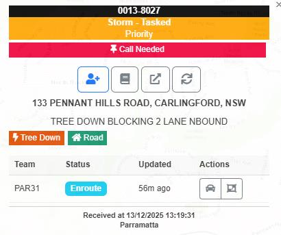

An incident popup can also be dragged onto a team in the Team Register to [task that team](tasking.md#drag--drop-team-tasking).

### Incident Popup Actions

**Incident details section**

- **Task Team**: opens [Instant Task](tasking.md#instant-task).
- **Incident Timeline**: opens the [Incident Timeline](incident-register.md#incident-timeline).
- **New Ops Log Entry**: opens [New Ops Log](logs-and-messages.md#new-ops-log).
- **Open Incident in Remote Tab**: opens the incident in the Beacon [remote tab](getting-started.md#remote-beacon-tab).
- **Refresh Incident**: reloads the incident's details, including tasked teams and their statuses.

**Incident taskings section**

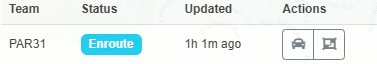

- **Team row**: click to zoom to the team's location and open it in the Team Register. A team with no tracked vehicle or radio just opens in the Team Register.
- **Team status**: click to [change the tasking status](tasking.md#tasking-status).
- **Route to Asset** (left button): shows a road route from the team's current location to the incident with an approximate ETA.
- **Fit Bounds** (right button): zooms in as far as possible while keeping both the team and incident in view.

### Hovering over an Incident

Hover over an incident marker to see a quick summary without opening its popup:

- Incident ID, priority and type (including the flood rescue category, e.g. `FR-1`)
- Address
- Situation on scene
- Status and assigned HQ
- ICEMS agencies involved, each with a coloured dot for its status. Hover over an agency to see its status in words.
- Outstanding *action required* tags: the first tag, plus how many more (e.g. *Call Made +1*)

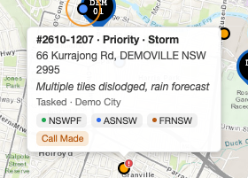

| Dot colour | Agency status |
| --- | --- |
| Green | On scene / responded |
| Blue | En route |
| Teal | Acknowledged / will attend |
| Amber | Requested / sent |
| Grey | Left scene / closed |
| Red | Will not attend / timed out |

> **Note:** ICEMS agencies appear once LAD has loaded them for that incident, which happens when you expand the incident in the register or when Beacon pushes an ICEMS update.

### Incident Status on Markers

When enabled under [Map Markers](configuration.md#incident-status-on-markers) (on by default), extra indicators are drawn on incident markers:

| Indicator | Meaning |
| --- | --- |
|  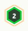 | **Unacknowledged**: a pulsing yellow circle. Also shown on a cluster that contains an unacknowledged incident. |
|  | **Active** (not tasked): a moving purple dotted ring that follows the marker's shape. |
| — | **Tasked**: no extra indicator. |
|  | **Referred, Complete or Finalised**: a black diagonal line through the icon. |
|  | **Cancelled or Rejected**: a black cross through the icon. |
| 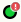 | **Action Required**: a red exclamation mark when the incident has an outstanding action required tag, whatever its status. |

### Incident Clustering

Incidents can be clustered to make them easier to access and to deal with overlapping addresses. Clustering is enabled by default and happens in two situations:

- **Incidents at the same address / GPS location**: stops incidents being missed when they're stacked on top of each other. The cluster shows how many incidents are at the location.
- **Incidents close together**: as you zoom out, incidents within a set distance of each other are grouped to keep the map readable.

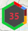

Clusters display as a hexagon. The number inside is the number of incidents in the cluster; a **red** number means at least one is a rescue incident.

The border works like a pie chart of incident priorities, using the same colours as the [Legend](#legend). For example, a cluster of 20 incidents with a border that is half green, a quarter blue and a quarter yellow contains 10 general, 5 immediate and 5 priority incidents.

Clustering settings are under [Incident Marker Clustering](configuration.md#incident-marker-clustering).

## Teams on the Map

Teams are shown at the position reported by their matched radio or satellite tracker. Click a team's marker to see the asset's details, the team it's matched to and that team's taskings. Assets have their own page, covering [radio matching](assets.md#setting-up-a-team-for-radio-tracking), the [asset popup](assets.md#asset-popup), [capability codes](assets.md#capability-codes), [overlapping markers](assets.md#overlapping-asset-markers) and [breadcrumb trails](assets.md#asset-breadcrumb-trails).

## Address Search

Open Address Search by right-clicking the map and choosing **Address Search**, or with the search tool  in the map controls.

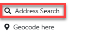

Type an address and results appear automatically. Select a result or press <kbd>Enter</kbd> to go to that address.

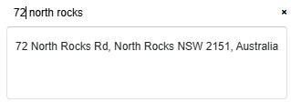

## Creating Incidents from the Map

You can create an incident from a map location using reverse geocoding.

1. Right-click the location and choose **Geocode here**.

   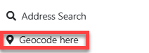

2. The map shows the nearest mappable addresses. Your selected location is a **red** pin and the found addresses are **blue** pins. Clicking anywhere else on the map cancels the search.

   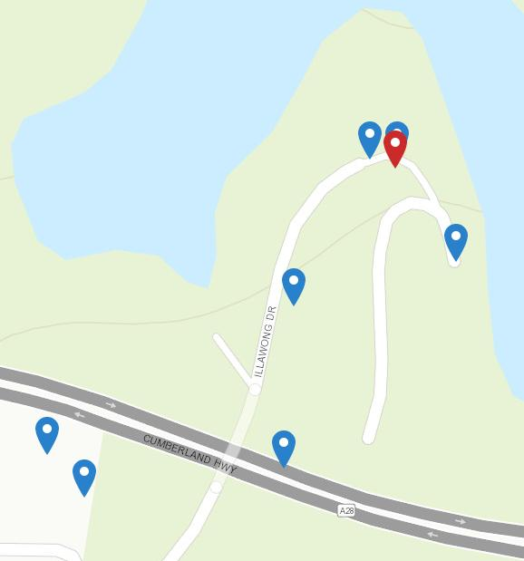

3. Click a blue pin to see the address, its distance from your red pin, the address type (e.g. *PointAddress* or *Street*), the area and the GPS coordinates.

   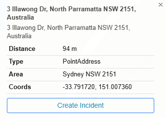

4. Click **Create Incident** to open Beacon's *Create New Incident* page in your [remote tab](getting-started.md#remote-beacon-tab) with the address pre-filled, then create the incident as normal.

## Collaborative Map Layers

Collaborative map layers let users place markers on the map that other users can see. You can create, view and edit multiple collaborative layers at once. Layers are managed on the **Collaborative layers** tab of the [Configuration](configuration.md) screen, and shown or hidden from the map's **Layers** menu.

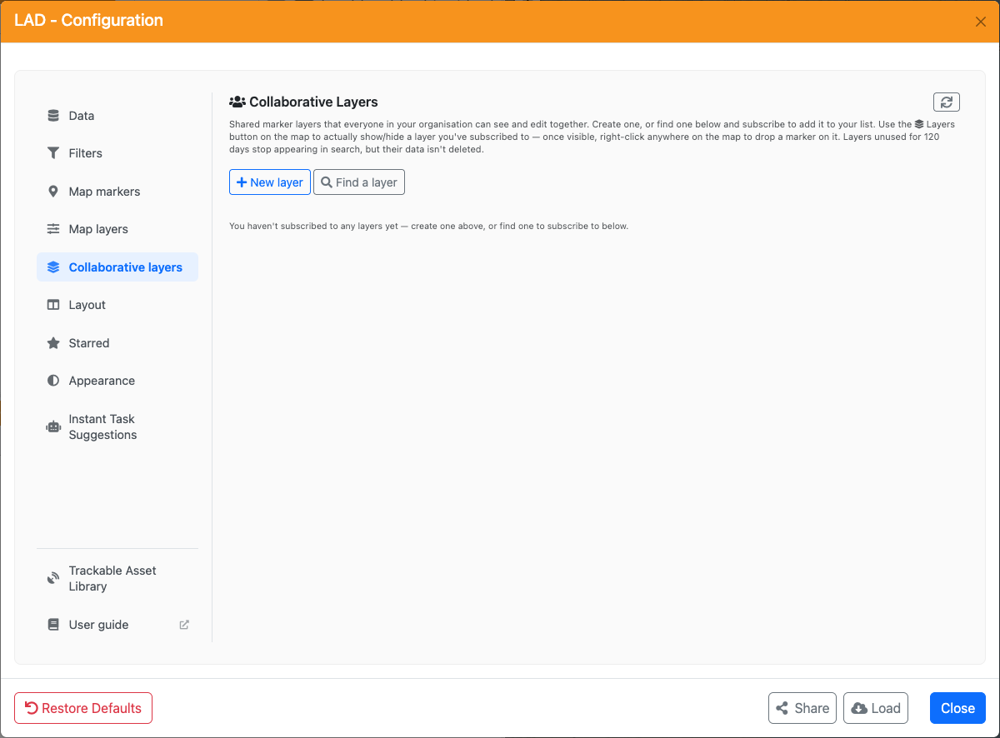

### Subscribing to a Layer

1. In Configuration, open the **Collaborative layers** tab and click **Find a layer**. You'll see all layers for the selected headquarters. Click the **X** to remove the headquarters and choose a different one, or leave it blank to search all headquarters.
2. Click **Subscribe** next to the layer you want.

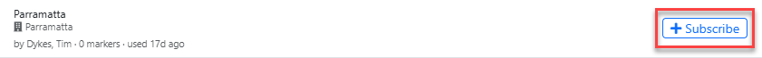

### Creating a New Layer

On the **Collaborative layers** tab, click **New layer**, enter a layer name and select the headquarters the layer belongs to.

Expand **Advanced options** for more settings:

- **Attach to event**: attach the layer to a specific event.
- **Marker permissions**: who can add, modify and delete markers on the layer.
- **Delete permissions**: who can delete the layer.
- **Comment permissions**: who can comment on markers on the layer.

If any setting gives permissions to moderators, a **Moderators** box appears. Add moderators by searching for their name or member number.

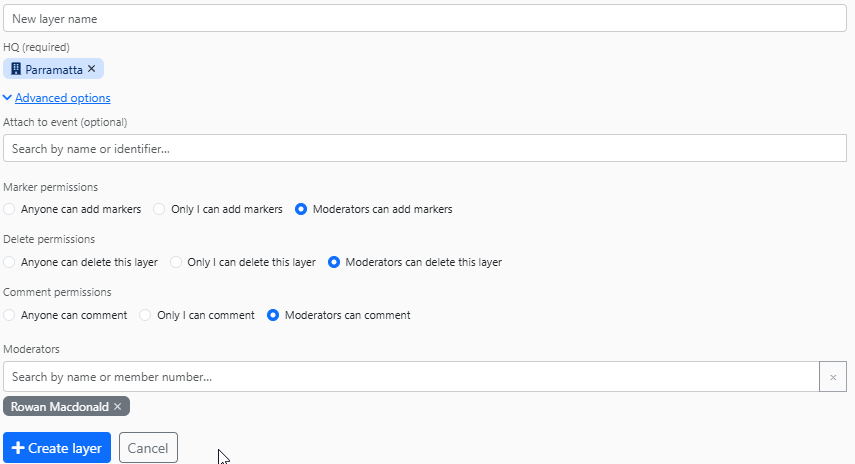

### Adding a Marker

1. Right-click the map and choose **Add marker to collaborative layer**.

   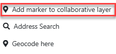

2. If you're subscribed to more than one layer, choose the layer to add the marker to.

   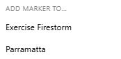

3. Choose the marker icon and colour, enter a title and description, and click **Save**. Actions on markers are logged to the Ops Log.

   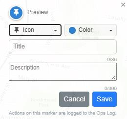

### Viewing and Changing a Marker

Click a marker to open it and see its details and comments.

- Use **Edit** or **Delete** to change or remove the marker.
- To comment, type in the comment field and click **Comment**.

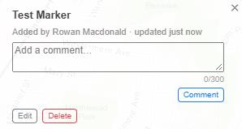
