# Spotlight

Spotlight is LAD's keyboard search and command bar. Open it with <kbd>Ctrl</kbd>/<kbd>Cmd</kbd> + <kbd>K</kbd> (the hotkey can be changed under [Appearance](configuration.md#appearance)).

Click the **?** button at the end of the search box, or type `?` in an empty search box, to open **Spotlight commands**: a list of every command, what Spotlight searches and its keyboard shortcuts. Click a command to go back to Spotlight with it typed in, or press <kbd>Esc</kbd> to go back without one.

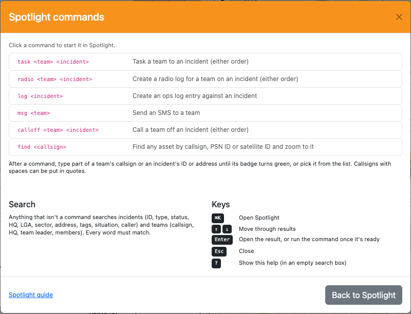

## Spotlight Menu

Spotlight searches incidents and teams within your LAD filters. Selecting a result takes you to that incident or team in its register and zooms the map to it (if it is on the map).

**Searchable incident fields:** ID, type, status, assigned HQ, LGA, address, tags, situation on scene, caller and contact details.

**Searchable team fields:** callsign, assigned HQ, team leader's name, team members' names.

## Spotlight Commands

Spotlight also accepts commands. Type the command name (e.g. `task`) and then provide the information it asks for. The command instructions appear under the search box once the command name is recognised.

| Command | What it does |
| --- | --- |
| `task` | [Task a team](#task-team-command--task) to an incident |
| `radio` | Create a [radio log](#radio-log-command--radio) against a team on an incident |
| `log` | Create an [ops log](#ops-log-command--log) entry against an incident |
| `find` | [Find any asset](#find-asset-command--find) and zoom the map to it |
| `msg` | [Send an SMS](#sms-team-command--msg) to a team |
| `calloff` | [Call off a team](#call-off-command--calloff) from an incident |

### Task Team command — `task`

Tasks a team to an incident. You need to provide a team and an incident, in either order.

1. Type `task`. The command instructions appear.

   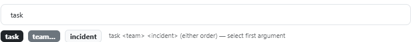

2. Start typing the team's name. LAD tries to match your text to a single team. Enter enough of the name to match just one, or select it from the results. You can search by any searchable team field. When matched, the **team** part of the instructions turns green.

   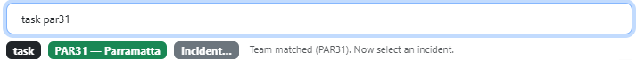

3. Search for the incident using any searchable incident field, such as ID or address. When matched, the **incident** part turns green.

   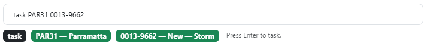

4. Press <kbd>Enter</kbd> to open the [tasking menu](tasking.md#tasking-the-team).

### Radio Log command — `radio`

Creates a radio log against a team on an incident. Works the same way as `task`: provide a team and an incident, in either order.

1. Type `radio`.

   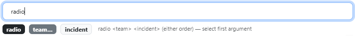

2. Type the team's name until the **team** part turns green.

   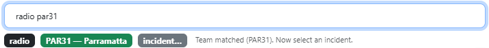

3. Search for the incident until the **incident** part turns green.

   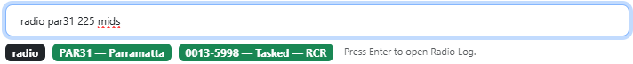

4. Press <kbd>Enter</kbd> to open the [New Radio Log](logs-and-messages.md#new-radio-log) dialog with the incident and team filled in. If the team is tasked to the incident you can [change its status](logs-and-messages.md#changing-the-teams-status); if not, you can [task it](logs-and-messages.md#tasking-the-team-from-a-log).

### Ops Log command — `log`

1. Type `log`.

   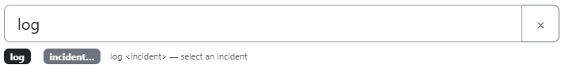

2. Select the incident from the list, or search by its address, situation on scene, headquarters or incident ID. The **incident** part turns green when matched.

   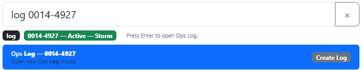

3. Press <kbd>Enter</kbd> to open the [New Ops Log](logs-and-messages.md#new-ops-log) dialog.

### Find Asset command — `find`

Finds any trackable asset, including ones not matched to a team, and zooms the map to it.

1. Type `find` followed by part of the asset's callsign, PSN radio ID or satellite ID (e.g. `find ctn7`).
2. Matching assets are listed with their capability and marker code, type, HQ, PSN ID and when they were last seen. Callsigns that start with what you typed come first.
3. Press <kbd>Enter</kbd> (or click an asset) to zoom to it and open its popup. If its [asset layer](assets.md#asset-layers) is hidden, LAD turns it on.

### SMS Team command — `msg`

1. Type `msg`. Teams are listed below the instructions.
2. Select the team from the list, or type any searchable team field (such as its callsign or a member's name) until the **team** part turns green.

   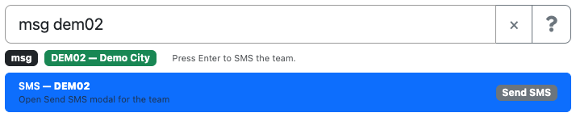

3. Press <kbd>Enter</kbd> to open the [Send SMS](logs-and-messages.md#send-sms) dialog with the team's members listed, the same as the team's **SMS** button.

### Call Off command — `calloff`

Calls a team off an incident. Like `task`, you can give the team and the incident in either order.

1. Type `calloff`.
2. Type the team's name until the **team** part turns green. Only incidents the team can be called off from are listed (taskings that are Tasked or En route).
3. Select the incident, or search for it until the **incident** part turns green. If you started with the incident, only teams that can be called off from it are listed.

   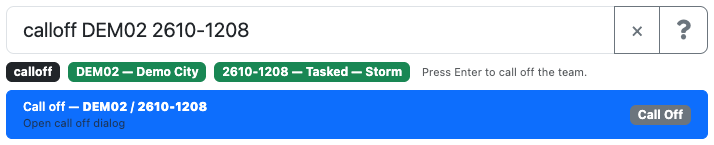

4. Press <kbd>Enter</kbd> to open the **Call off** dialog, type the reason, then click **Call off** (or press <kbd>Ctrl</kbd>/<kbd>Cmd</kbd> + <kbd>Enter</kbd>). The Call off button stays greyed out until you enter a reason.

   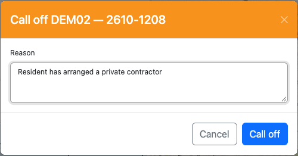
