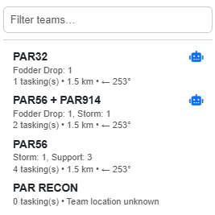
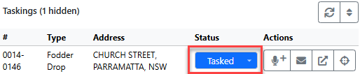

# Tasking Teams

There are four ways to task a team to an incident in LAD:

- **Instant Task**: click **Task** on an incident in the [Incident Register](incident-register.md#incident-actions), or **Task Team** in its [map popup](situation-map.md#incident-popup-actions).
- **Drag & drop**: drag an incident onto a team in the Team Register.
- **Spotlight**: type `task`, then a team and an incident. See [Task Team command](spotlight.md#task-team-command--task).
- **From a radio or ops log**: fill in the log's **Incident** and **Team**, then choose **Task Team** or **Task Team & SMS**. The team is tasked when you submit the log. See [Tasking the Team from a Log](logs-and-messages.md#tasking-the-team-from-a-log).

Once tasked, the tasking shows under the team in the [Team Register](team-register.md#team-taskings) and under the incident in the [Incident Register](incident-register.md#incident-taskings-actions), where you can [update its status](#tasking-status).

## Instant Task

Clicking **Task Team** opens the Instant Task dialog, which lists filtered teams. Use the search bar to find a team by name. Teams are ordered by distance to the incident (geocoded incidents only). Distance is calculated from the team's matched asset, or its [default asset](team-register.md#default-asset) if it has more than one.

Each team shows:

- Number of current taskings and the types of tasked incidents (flood rescues also show their category)
- Distance (straight line)
- Compass bearing from the incident

### Instant Task Suggestions

Teams marked with a blue robot icon  are **Instant Task Suggestions**. LAD picks the most appropriate team based on each team's distance and tasking count. Suggestions **do not take team capabilities into account**.

- **Rescue priority**: the nearest team with zero active taskings is preferred. If every team already has a tasking, LAD falls back to the weighted score. This means a suggestion may be geographically further away.
- **All other priorities**: every team is scored on a weighted combination of distance and tasking count, and the highest-scoring team is suggested.

Suggestions can be turned off, and the weights and road travel times changed, under [Instant Task Suggestions](configuration.md#instant-task-suggestions) in Configuration.

### Tasking the Team

Clicking a team shows a confirmation with three options:

- **Cancel**
- **Task & SMS Details**: tasks the team and opens [Send SMS](logs-and-messages.md#send-sms) addressed to the team, pre-filled with the incident details (similar to the message Beacon generates when creating an incident).
  - Cancelling the SMS only cancels the SMS. The team is still tasked.
- **Task**

## Drag & Drop Team Tasking

Drag an incident from the Incident Register onto a team in the Team Register to task that team. Click and hold on the blue **+** / **−** icon at the left of the incident row, then drag it onto a team row.

Incident popups on the Situation Map can also be dragged onto a team in the Team Register.

## Finding Nearby Teams

- **Target Teams** on an expanded incident finds the closest teams and shows their straight-line distance to the incident.
- In an incident's map popup, **Route to Asset** shows a road route from a tasked team's current location to the incident with an approximate ETA, and **Fit Bounds** zooms to show both. See [Incident Popup Actions](situation-map.md#incident-popup-actions).

## Tasking Status

Each tasking shows its status, in both registers and in the incident's map popup. Click the status to open a dropdown and choose a new one. Some statuses need extra information:

- **Remove Tasking**: only available in the *Tasked* status. Removes the tasking from the team.
- **En-Route**: requires a time, defaulting to now (tick the override to enter your own). You can set an ETA; the quick ETA buttons add increments, and when the ETA is blank they add to the time set.
- **Call Off**: requires a reason.
- **On-Site**: requires a time, defaulting to now (tick the override to enter your own). You can set an ETC; the quick ETC buttons work the same way as quick ETA.
- **Off-Site**: requires a time, defaulting to now (tick the override to enter your own).
- **Complete**: opens Beacon's *Team Completion* dialog for the team in the remote tab.

You can also change a tasking's status while logging a radio message: click the tasking's **Radio Log** button and pick the new status at the bottom of the dialog. See [Changing the Team's Status](logs-and-messages.md#changing-the-teams-status).

To change the order of a team's taskings, see [Reordering Taskings](team-register.md#reordering-taskings).
