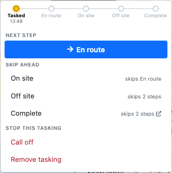
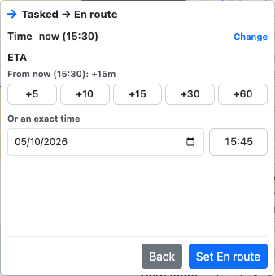
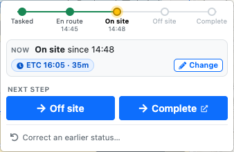
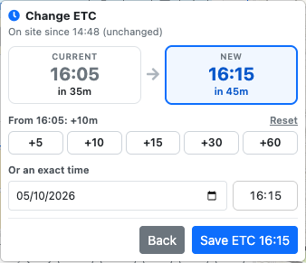
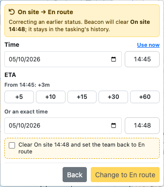
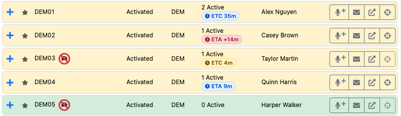
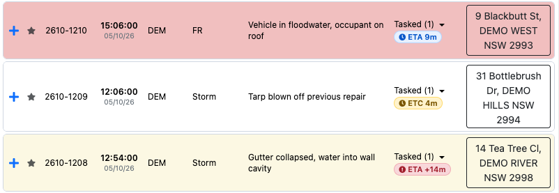

# Tasking Teams

There are four ways to task a team to an incident in LAD:

- **Instant Task**: click **Task** on an incident in the [Incident Register](incident-register.md#incident-actions), or **Task Team** in its [map popup](situation-map.md#incident-popup-actions).
- **Drag & drop**: drag an incident onto a team in the Team Register.
- **Spotlight**: type `task`, then a team and an incident. See [Task Team command](spotlight.md#task-team-command--task).
- **From a radio or ops log**: fill in the log's **Incident** and **Team**, then choose **Task Team** or **Task Team & SMS**. The team is tasked when you submit the log. See [Tasking the Team from a Log](logs-and-messages.md#tasking-the-team-from-a-log).

Once tasked, the tasking shows under the team in the [Team Register](team-register.md#team-taskings) and under the incident in the [Incident Register](incident-register.md#incident-taskings-actions), where you can [update its status](#tasking-status).

## Instant Task

Clicking **Task Team** opens the Instant Task dialog, which lists filtered teams. Use the search bar to find a team by name. Teams are ordered by distance to the incident (geocoded incidents only). Distance is calculated from the team's matched asset, or its [default asset](team-register.md#default-asset) if it has more than one.

Each team shows:

- Number of current taskings and the types of tasked incidents (flood rescues also show their category)
- Distance (straight line)
- Compass bearing from the incident

### Instant Task Suggestions

Teams marked with a blue robot icon  are **Instant Task Suggestions**. LAD picks the most appropriate team based on each team's distance and tasking count. Suggestions **do not take team capabilities into account**.

- **Rescue priority**: the nearest team with zero active taskings is preferred. If every team already has a tasking, LAD falls back to the weighted score. This means a suggestion may be geographically further away.
- **All other priorities**: every team is scored on a weighted combination of distance and tasking count, and the highest-scoring team is suggested.

Suggestions can be turned off, and the weights and road travel times changed, under [Instant Task Suggestions](configuration.md#instant-task-suggestions) in Configuration.

### Tasking the Team

Clicking a team shows a confirmation with three options:

- **Cancel**
- **Task & SMS Details**: tasks the team and opens [Send SMS](logs-and-messages.md#send-sms) addressed to the team, pre-filled with the incident details (similar to the message Beacon generates when creating an incident).
  - Cancelling the SMS only cancels the SMS. The team is still tasked.
- **Task**

## Drag & Drop Team Tasking

Drag an incident from the Incident Register onto a team in the Team Register to task that team. Click and hold on the blue **+** / **−** icon at the left of the incident row, then drag it onto a team row.

Incident popups on the Situation Map can also be dragged onto a team in the Team Register.

## Finding Nearby Teams

- **Target Teams** on an expanded incident finds the closest teams and shows their straight-line distance to the incident.
- In an incident's map popup, **Route to Asset** shows a road route from a tasked team's current location to the incident with an approximate ETA, and **Fit Bounds** zooms to show both. See [Incident Popup Actions](situation-map.md#incident-popup-actions).

## Tasking Status

Each tasking shows its status, in both registers and in the incident's map popup. Click the status to open the status menu.

The menu is built to move the tasking forward, towards completion:

- The **progress line** at the top shows where the tasking is (Tasked, En route, On site, Off site, Complete) and the time of each step so far.
- **Next step** is the big blue button for the usual next status, e.g. *On site* for a team that's En route. From On site there are two, side by side: **Off site** and **Complete**.
- **Skip ahead** lists the later statuses, with the steps each one skips, e.g. *Off site · skips On site*. **Complete** opens Beacon's *Team Completion* dialog for the team in the [remote tab](getting-started.md#remote-beacon-tab).
- **Stop this tasking** has **Call off** (Tasked or En route; requires a reason) and **Remove tasking** (Tasked only). Call off is offered exactly when Beacon allows it: not once a team has arrived on site, unless its arrival was corrected back to En route, and never once it has been Off site. Those teams have to be completed in Beacon. You can also call a team off from Spotlight with the [`calloff` command](spotlight.md#call-off-command--calloff).

After choosing a status, the menu shows what's changing, e.g. *Tasked → En route*, and you confirm it with the button at the bottom, e.g. **Set En route**. Some statuses need extra information:

- **En route**, **On site** and **Off site** are logged at the current time. To log a different time, click **Change** beside it; **Use now** goes back to the current time.
- **En route** can have an ETA, and **On site** an ETC. Each click of a quick button (+5 to +60) adds to the ETA/ETC picked so far, starting from the status time. The label above the buttons shows how far the ETA/ETC is after the status time, e.g. *From now (10:00): +45m*; it only changes its *From* time if you change the status time. You can also type an exact date and time; times are 24-hour, e.g. `1045` or `10:45`.
- **Call off** requires a reason.

### Changing the ETA or ETC

While a team is En route or On site, the **Now** box in the status menu shows its current ETA or ETC. Click **Change** (or **Set ETA** / **Set ETC** if there isn't one) to give a new time without changing the status:

- The current and new times show side by side, with how far away each is.
- Each click of a quick button (+5 to +60) adds to the time picked so far, starting from the current ETA or ETC, or from now if that has already passed. The label above the buttons shows how far the new time is after that, e.g. *From 10:35: +20m*. **Reset** goes back to the current time, or type an exact time instead (24-hour).
- Click **Save ETA** / **Save ETC**. The time the team went En route or On site stays the same.

### Correcting an Earlier Status

Earlier statuses aren't in the normal menu, so they can't be chosen by accident. To fix a mistake, e.g. a team marked On site that's still on the way:

1. Click **Correct an earlier status…** at the bottom of the menu. It only shows when there's an earlier status to go back to: Off site can go back to On site or En route, and On site can go back to En route.
2. Choose the status. Each option shows which later status times Beacon will clear. They stay in the tasking's history in Beacon.
3. Check the time and ETA or ETC. They start at the values the status had before; click **Use now** to log it at the current time instead.
4. Tick the box to confirm, then click **Change to …**.

Correcting a team back from On site to En route makes **Call off** available again. Correcting back from Off site doesn't: the confirmation warns that Beacon still needs the team completed.

The change is recorded in Beacon with the note *Status corrected from … to … (Lighthouse)*. Complete, Called off and Untasked can't be undone from LAD.

## Arrival and Completion Times

When a team is set to *En-Route* with an ETA, or *On-Site* with an ETC, LAD counts down to that time:

- **ETA** (estimated time of arrival) shows while the team is *Enroute*.
- **ETC** (estimated time of completion) shows while the team is *Onsite*.

Teams in any other status, or without an ETA or ETC, don't show one. The times come from Beacon, so an ETA set in Beacon, or by another LAD user, shows too. The countdown updates every 30 seconds, and its colour shows how the team is tracking:

| Colour | Meaning |
| --- | --- |
| Blue | On track, e.g. *ETA 9m* |
| Amber | Due within 5 minutes |
| Red | Overdue, e.g. *ETA 14m late* |

In the Team and Incident Registers, the countdown is shortened to fit: overdue times show as *ETA +14m*, and times over an hour show in whole hours, e.g. *ETA +5h* or *ETC 2h*. Hover over a countdown to see the exact clock time. It shows in:

- **Team Register**: under the task count, the team's soonest ETA. A team with no ETA shows its soonest ETC instead. If the team has several taskings, hover over the countdown to see which incident it's for, or expand the team to see them all.

  
- **Incident Register**: under the status, the soonest ETA of the teams tasked to the incident, or else the soonest ETC.

  
- **Expanded teams and incidents**, and the **incident map popup**: the clock time and countdown for each tasking, e.g. *ETC 10:35 · 35m*.
- **Asset map popup**: beside each of the team's taskings.
- **Incident hover tooltip** on the map: one badge per team, e.g. *DEM04 · ETA 9m*.

A team that is 5 minutes or more past its ETA or ETC is also listed in the *Teams overdue on ETA/ETC* [alert](interface.md#alerts).

You can also change a tasking's status while logging a radio message: click the tasking's **Radio Log** button and pick the new status at the bottom of the dialog. See [Changing the Team's Status](logs-and-messages.md#changing-the-teams-status).

To change the order of a team's taskings, see [Reordering Taskings](team-register.md#reordering-taskings).
