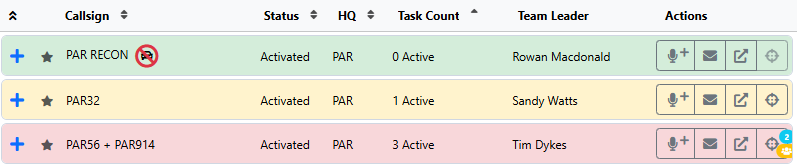
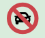
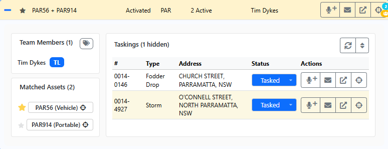
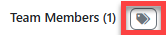
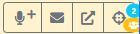
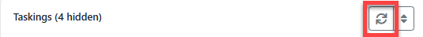
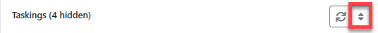
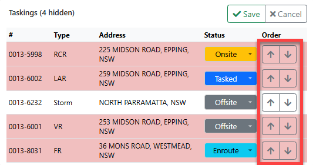
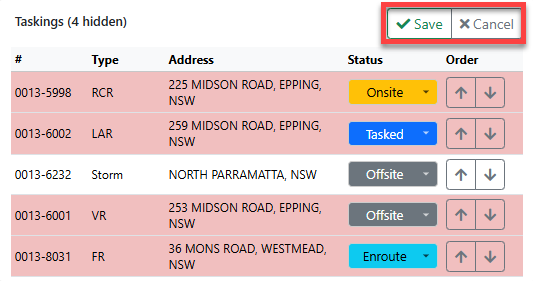
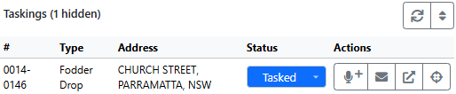

# Team Register

The Team Register is in the top left of LAD. It lists all filtered teams. Each row displays:

- Callsign
- Status
- HQ (assigned HQ)
- Task count: current active taskings (Tasked, Enroute, Onsite and Offsite)
- Team leader

Sort by Callsign, Status, HQ or Task Count by clicking the column heading; click again to swap between ascending and descending.

Each row's background colour shows the team's current tasking load, so you can quickly spot teams that are (or will soon be) available, teams that may be overloaded, or teams yet to complete their taskings in Beacon:

| Colour | Active taskings |
| --- | --- |
| Green | None |
| Yellow | 1–2 |
| Red | More than 2 |

> **Note:** The task count includes taskings to incidents outside your LAD incident filters (e.g. local storm incidents when your filter is set to flood rescues only).

If a team can't be matched to a radio asset, a car icon with a cross through it  shows next to its callsign and the map focus button is disabled. See [Setting up a Team for Radio Tracking](assets.md#setting-up-a-team-for-radio-tracking).

## Expanded Team Details

Click anywhere on a team row to expand it. The expanded view lists team members (including the team leader) and the team's taskings.

The taskings list is filtered by the **Tasking Status** filter and shows all matching taskings, including incidents outside your incident filter. By default this is Tasked, Enroute, Onsite and Offsite.

### Matched Assets

The bottom left of the expanded view lists each matched radio or satellite tracker. Click one to zoom to it on the Situation Map.

Which assets are matched depends on the team's name. See [Assets & Radio Tracking](assets.md#setting-up-a-team-for-radio-tracking).

### Default Asset

When a team has more than one matched asset, a star shows next to each one. The gold star marks the team's **default asset**, which LAD uses as the team's location for:

- [Instant Task](tasking.md#instant-task) distances, bearings and [suggestions](tasking.md#instant-task-suggestions)
- routes and distance lines from the team to an incident

A team with only one matched asset has no stars, and that asset is always used.

- Until someone chooses one, the default is the first asset in the list.
- Click a faded star to make that asset the default. Click the gold star to clear the choice and go back to the first asset.
- The choice is shared with all LAD users. Other browsers pick it up when they next refresh their asset data.
- An asset can be the chosen default for only one team. Choosing it for another team clears it from the first.

The focus button and [In Map View](interface.md#listing-only-whats-in-the-map-view) still use all of a team's matched assets.

### Toggle Member Capability

Show or hide member capabilities with the tags icon to the right of the **Team Members** heading. Hidden by default.

## Team Row Actions

Each team row has four action buttons:

- **Radio Log**: opens [New Radio Log](logs-and-messages.md#new-radio-log) against the team.
- **Message Team**: opens [Send SMS](logs-and-messages.md#send-sms) with the team members as recipients. Greyed out if the team has no members.
- **Open in Remote Tab**: opens the team's edit page in the Beacon [remote tab](getting-started.md#remote-beacon-tab), e.g. to change the team's name or members.
- **Focus on map**: focuses the Situation Map on the team's radio location. Greyed out if no radios are matched.
  - If multiple radios are matched, the button shows the count  and toggles between them on each click.
  - If one radio is matched to multiple teams, a yellow group icon  is shown.

## Team Taskings

The Team Taskings section lists incidents tasked to the team that are within your LAD filters and tasking statuses. If the team has taskings outside your filters, a **(x hidden)** count appears next to the **Taskings** heading.

### Refresh

Click **Refresh** to reload the team's tasking details.

### Reordering Taskings

1. Click the reorder button to enter reordering mode.

   

2. Use the up and down arrows next to each tasking to change the order.

   

3. Click **Save** to confirm, or **Cancel** to discard your changes.

   

## Team Tasking Actions

Each tasking under a team has four actions:

- **Radio Log** (against the incident): opens [New Radio Log](logs-and-messages.md#new-radio-log), logged against the incident and including the team's callsign.
- **Message Team** (against the incident): opens [Send SMS](logs-and-messages.md#send-sms) with the team members as recipients, associated with the incident.
- **Open Incident in Remote Tab**: opens the incident in the Beacon remote tab.
- **Focus on map**: focuses the Situation Map on the incident if it is geocoded and within your incident filters. Greyed out if the incident is outside your filters (it won't be on the map).

## Tasking Status

Click a tasking's status to change it, e.g. to *En-Route* or *On-Site*. See [Tasking Status](tasking.md#tasking-status).
