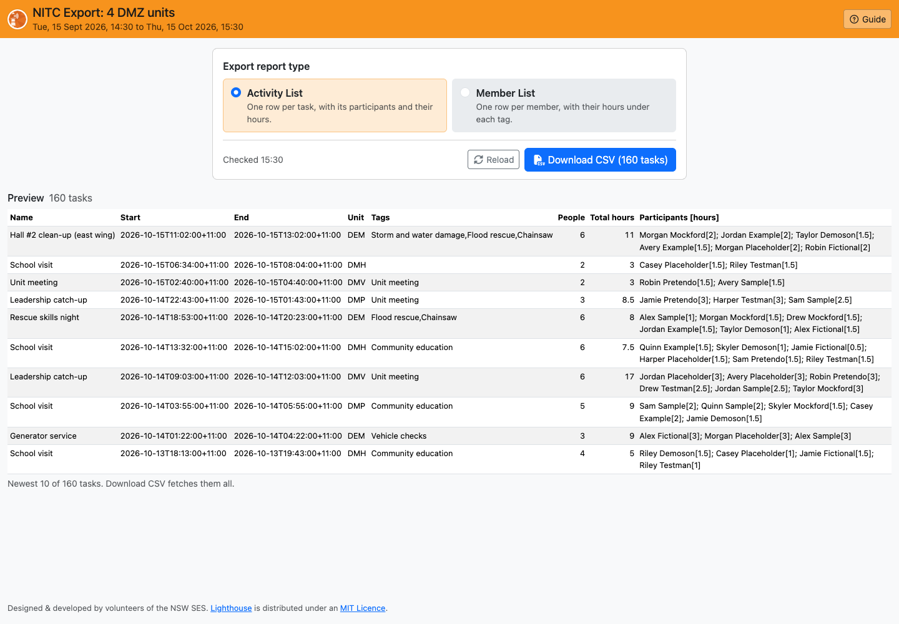
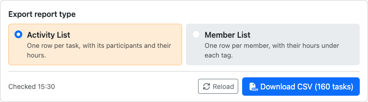
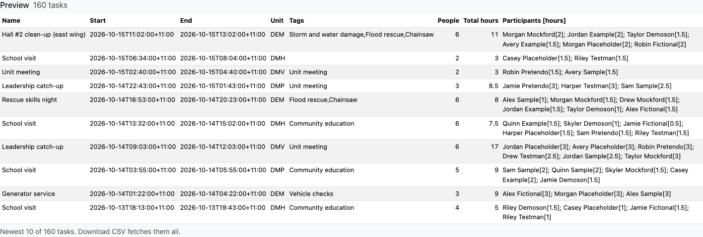
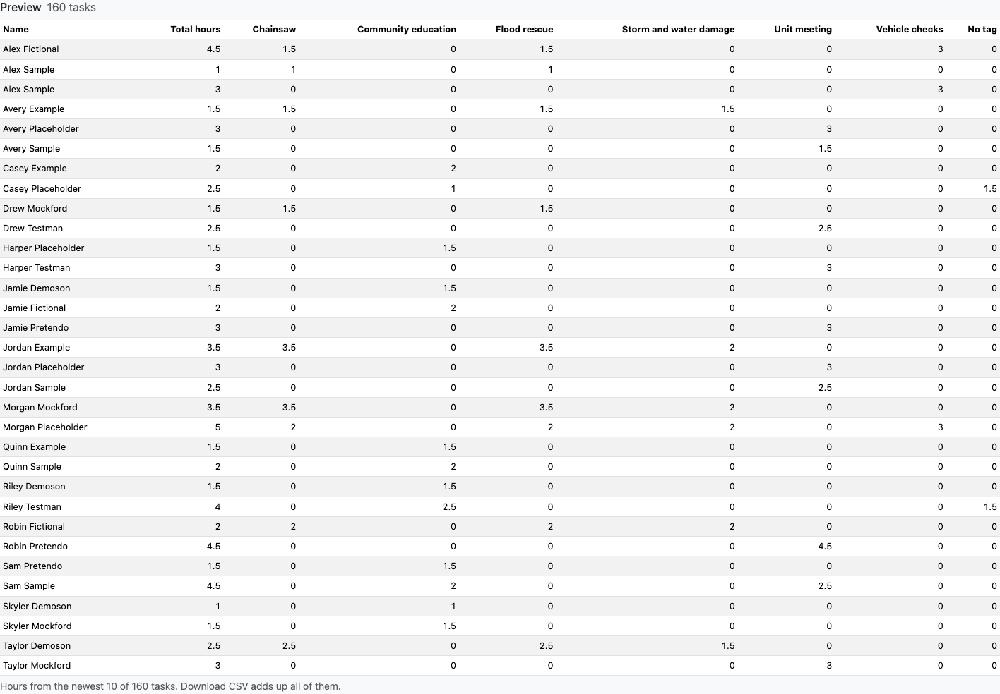
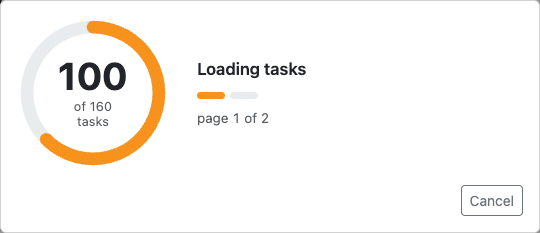
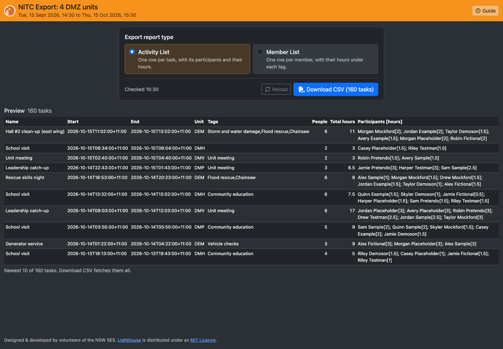

# NITC Export

NITC Export downloads your Non-Incident Task Cards (NITC: training, community engagement, maintenance, meetings and so on) as a CSV file you can open in Excel or Google Sheets. There are two reports: a list of the tasks with who took part, and a list of members with their hours under each tag.

> **Note:** Screenshots showing "Demo City" use made-up data.

## Opening NITC Export

On Beacon's **NITC** screen, filter the task list as you want it (HQs, dates, task types, tags, whether to include completed tasks), then click **Export (Filtered)** above the list. NITC Export opens in a new tab with the same filters.

The header names the HQs and shows the date range, plus the type and tag filters if you set any. It's coloured by the Beacon the page was opened from, as in LAD: orange for Beacon, green for Train Beacon and blue for Dev Beacon.

## Opening the Page

When the page opens, it asks Beacon for just the newest 10 tasks and how many tasks match, which is quick even for a long date range. All the tasks are only fetched when you click **Download CSV**.

If Beacon can't be reached, a message says why, with a **Try again** button. A *401* error means your Beacon login has expired: open NITC Export from Beacon's NITC screen again.

**Reload** (next to Download) checks Beacon again for the preview and the count, for example to see tasks added since you opened the page. If it fails, the preview you had stays, and a message says so.

## Choosing a Report

- **Activity List:** one row per task, with its participants and their hours.
- **Member List:** one row per member, with their total hours and their hours under each tag.

The page remembers your choice for next time.

## Preview

Under the report choice, the preview shows the report built from the newest 10 tasks. It changes when you pick the other report, without asking Beacon again. The download covers every task, not just these 10.

For the Member List, the preview only adds up the hours from those 10 tasks. The download adds up all of them.

## Downloading

Click **Download CSV**. The page fetches every matching task from Beacon (100 at a time), so a ring counts them as they arrive. The file is saved when they're all in, named after the report, the HQs and the time, e.g. *NITC activities - Demo City - 2026-10-15 1530.csv* or *NITC members - Demo City - 2026-10-15 1530.csv*. Each click fetches the tasks again, so the file is always up to date.

**Cancel** stops the download. If Beacon can't be reached, the message says why, with **Try again** and **Close**.

### Activity List columns

| Column | What's in it |
| --- | --- |
| **Name** | The task's name, as in Beacon |
| **StartDate**, **EndDate** | When the task started and ended |
| **Unit** | The code of the HQ that created the task |
| **Tags** | The task's tags, with commas between them |
| **TotalParticipants** | How many members took part |
| **TotalHours** | Everyone's hours added up |
| **Participants** | Each member with their hours in square brackets, separated by semicolons, e.g. *Alex Sample[2.5]; Sam Example[3]* |

### Member List columns

| Column | What's in it |
| --- | --- |
| **Name** | The member's name. Two members with the same name get a row each. |
| **TotalHours** | The member's hours over all the tasks |
| *One column per tag* | The member's hours on tasks with that tag, A to Z |
| **No tag** | The member's hours on tasks with no tags (only when there are any) |

A task with two tags counts its hours under both, so the tag columns can add up to more than **TotalHours**.

### Hours and times

- A member's hours on a task are from when they signed on to when they signed off, to 2 decimal places. If Beacon has no sign-off time for them, the task's end time is used.
- **Times** are in ISO 8601 format with the offset from UTC, e.g. *2026-10-15T09:41:00+11:00*: NSW time, with +11:00 in daylight saving and +10:00 outside it.
- The first row has the same column names as the old export, so spreadsheets built on it still work.

## Dark Mode

The page follows your computer's light or dark mode.

