# Incident Statistics

Incident Statistics shows how many incidents an HQ has had over a period, what kind they were, and how long they took to complete. Every chart filters every other one: click a slice or drag across a time chart, and the rest of the page updates to match.

> **Note:** Screenshots showing "Demo City" use made-up data.

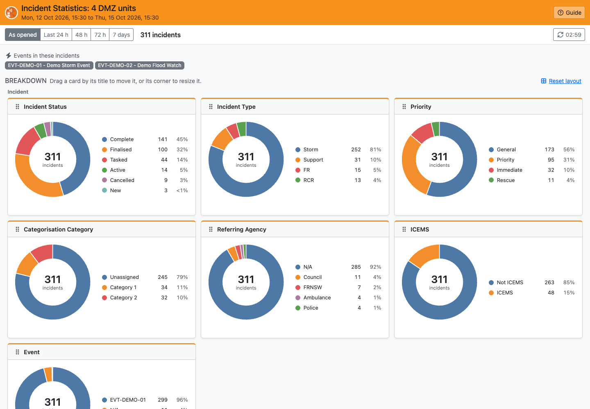

## Opening Incident Statistics

- **From the Lighthouse menu in Beacon:** choose **Incident Statistics (*your HQ* Today)**. This opens today's incidents for the HQ you're logged in to.
- **From Beacon's Jobs screen:** filter the incident list as you want it (HQs and dates), then click **Statistics (Filtered)** above the list. Incident Statistics opens with the same HQs and date range.

If no HQ is selected, the page covers all of NSW.

The **Guide** button at the top right of the page opens this guide.

## Loading

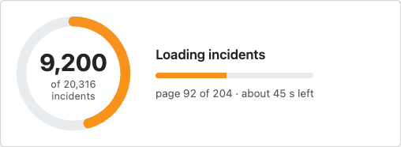

Incident Statistics fetches incidents from Beacon 100 at a time, so a big range can take a while. Until Beacon answers the first request, the ring spins with *Asking Beacon for incidents…* and how long it has been waiting. Then it counts the incidents as they arrive, with the page it's on and an estimate of the time left. *Building charts…* shows briefly at the end.

If Beacon hasn't answered after 10 seconds, the page says it's still waiting and offers **Load the last 24 h instead**.

## The Toolbar

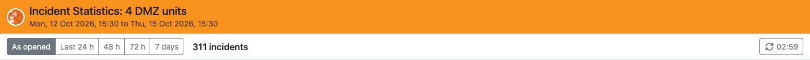

The heading shows which HQs the statistics cover and the date range. Its colour shows which Beacon the page was opened from, the same as in LAD: orange for Beacon, green for Train Beacon and blue for Dev Beacon. The cards have a matching coloured top edge.

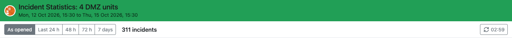

| Control | What it does |
| --- | --- |
| **As opened** / **Last 24 h** / **48 h** / **72 h** / **7 days** | The time range. **As opened** is the range the page was opened with. The others count back from now. Changing the range reloads the incidents. |
| Incident count | How many incidents are loaded, or how many match your filters (e.g. *249 of 299 incidents selected*). |
| **Clear all filters** | Shows when any chart is filtered. Removes every filter. |
| Refresh button | Counts down to the next automatic refresh (every 3 minutes). Click it to refresh now. A spinner shows while it refreshes. |

Your filters stay in place when the page refreshes.

If Beacon can't be reached, a message says why, with a **Try again** button. The page also tries again by itself: after a minute, then less often while Beacon keeps failing (up to every 10 minutes), so a screen left showing the statistics recovers without anyone touching it. If a refresh fails, the charts you had stay on screen until one succeeds. A *401* error means your Beacon login has expired: open Incident Statistics from Beacon again.

The page follows your computer's light or dark mode setting.

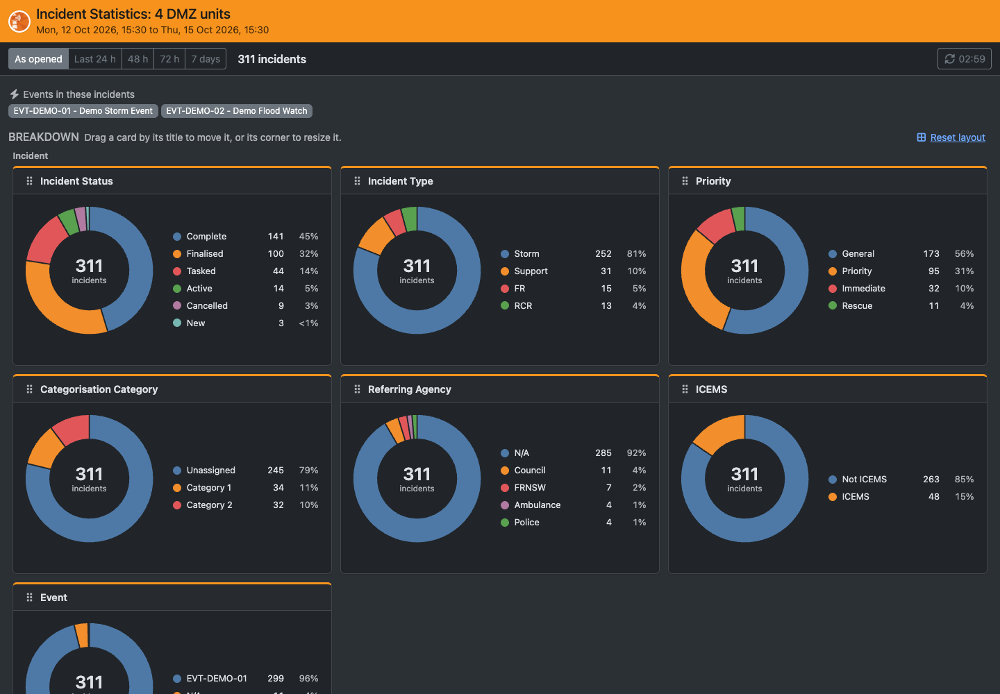

## Filtering

Click a slice of any pie chart, or its row in the legend, to show only those incidents. Click more slices to add them. Click a selected slice again to remove it.

Every other chart, the completion times, the latest incidents table and the word cloud then show only the selected incidents. The chart you filtered shows its selection next to its title, with a **reset** link to clear it, and the middle of its donut shows how many incidents are selected.

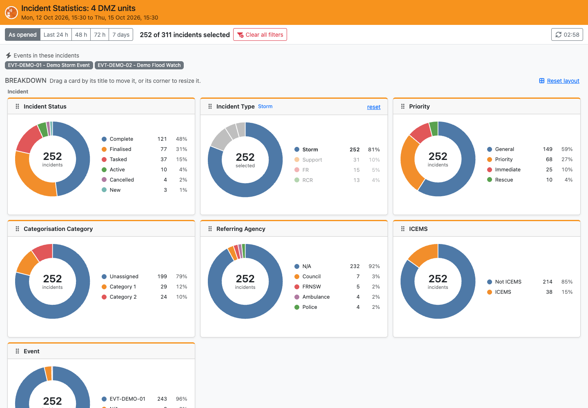

Filters on different charts combine. For example, selecting *Storm* under **Incident Type** and *Demo Heights* under **Assigned Unit** shows storm incidents for Demo Heights only.

## Breakdown

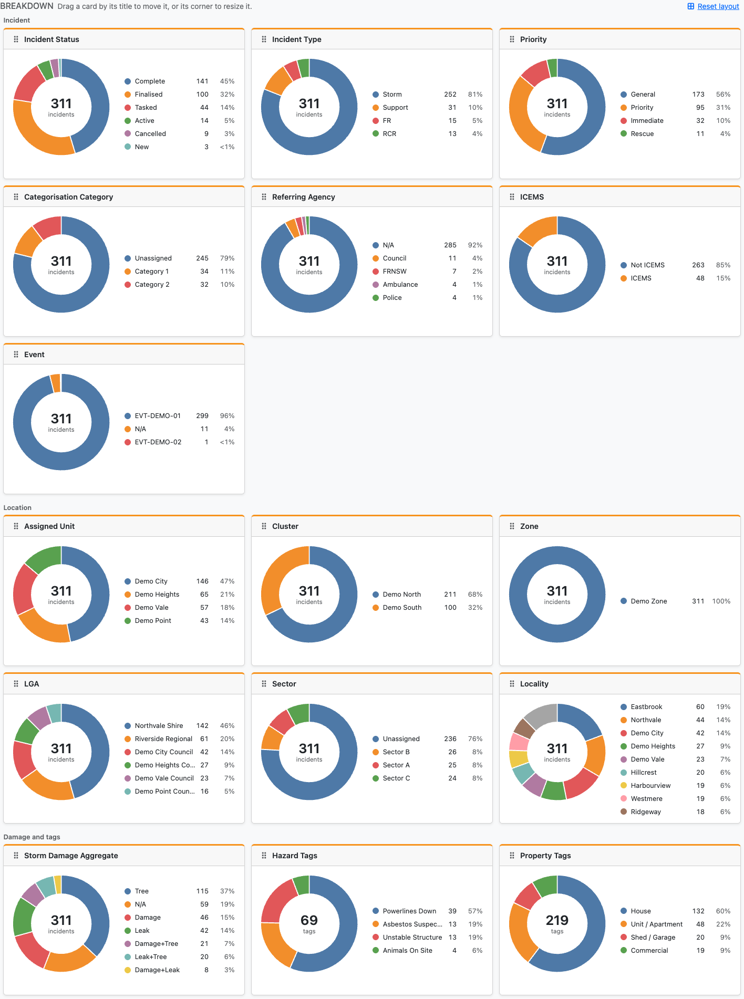

Each donut chart counts the incidents by one field. The legend beside it lists each slice with its count and percentage. Hover over a slice or a legend row to highlight the pair, and the middle of the donut shows that slice's count, percentage and name. Charts with many values show the nine biggest and group the rest as **Others** (always grey). No two slices in a chart share a colour.

The charts are in three groups:

| Group | Chart | Counts incidents by |
| --- | --- | --- |
| Incident | **Incident Status** | Current status (New, Active, Tasked, Complete, Cancelled, Finalised...) |
| | **Incident Type** | Storm, Flood Rescue, Road Crash Rescue, Support and so on |
| | **Priority** | General, Priority, Immediate, Rescue |
| | **Categorisation Category** | The incident's first categorisation category, or *Unassigned* |
| | **Referring Agency** | The agency that referred the incident, or *N/A* |
| | **ICEMS** | *ICEMS* for incidents that came in from another agency through ICEMS, *Not ICEMS* for the rest |
| | **Event** | The event the incident belongs to, or *N/A*. The events in the loaded incidents are also listed under the toolbar. |
| Location | **Assigned Unit** | The HQ the incident is assigned to |
| | **Cluster** | The assigned unit's cluster |
| | **Zone** | The assigned unit's zone |
| | **LGA** | The local government area of the incident's address |
| | **Sector** | The incident's sector, or *Unassigned* |
| | **Locality** | The suburb of the incident's address |
| Damage and tags | **Storm Damage Aggregate** | The kinds of storm damage in the incident's tags: *Tree*, *Damage* (roof, ceiling, wall, door, window, collapse) and *Leak*, combined when there's more than one (e.g. *Damage+Tree*). *N/A* means none of these tags. |
| | **Hazard Tags** | Hazard tags. An incident with several hazard tags counts once under each, so the middle of the donut counts tags, not incidents. |
| | **Property Tags** | Property type tags, counted the same way as hazard tags. |

### Arranging the Charts

- **Move a chart:** drag it by its title bar to another place in its group. The other charts make room.
- **Resize a chart:** drag its bottom-right corner. The donut grows with the card. Make a chart wide to give a long legend more room.
- **Reset layout** (above the charts) puts every chart back where it started.

Your layout, each chart's position and size, is saved in your browser and comes back next time you open Incident Statistics. Narrower windows show two charts per row, or one, and keep a layout of their own, so arranging the charts in a small window doesn't change your full-width layout.

## Completion Times

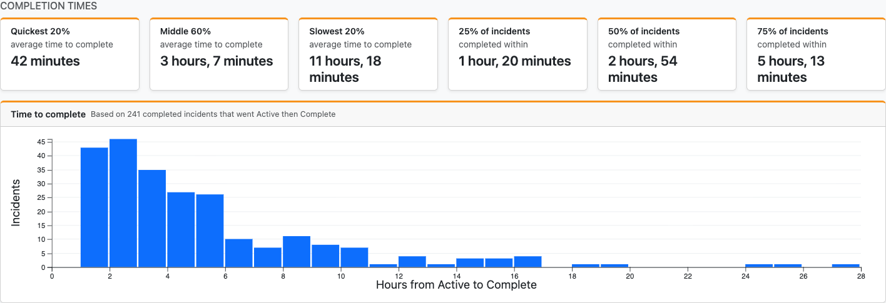

How long incidents took, from when they first went **Active** to when they first went **Complete**. Only incidents with both statuses count: incidents still open, cancelled, or completed without going Active first are left out. The line above the chart says how many incidents the figures are based on.

| Figure | Meaning |
| --- | --- |
| **Quickest 20%** | The average time of the fastest fifth of incidents |
| **Middle 60%** | The average time of the incidents in between, which is the typical incident |
| **Slowest 20%** | The average time of the slowest fifth |
| **25% / 50% / 75% of incidents completed within** | A quarter, half and three quarters of incidents were completed in this time or less |

The **Time to complete** chart shows how many incidents took each length of time. Drag across it to select a range of completion times, e.g. to see what the slowest incidents have in common.

## Over Time

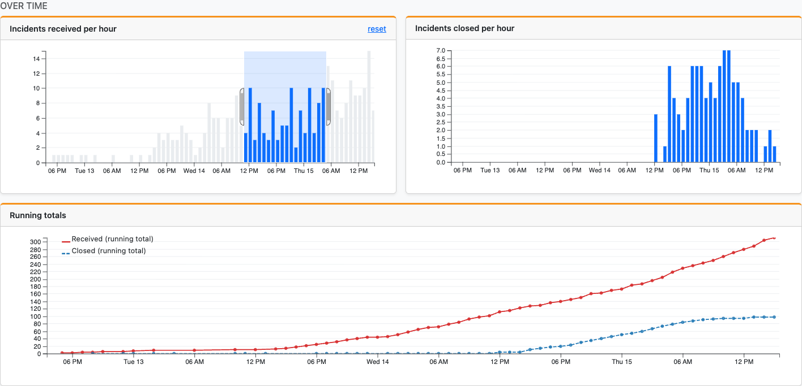

- **Incidents received per hour** and **Incidents closed per hour** count incidents by when they came in and when they were closed (Complete, Cancelled or Finalised). Ranges over two weeks show days instead of hours.
- Drag across either chart to select a period. The rest of the page shows only incidents received (or closed) in that period. Drag the selection to move it, or click **reset** to clear it.
- **Running totals** shows the total received and closed so far at each point in the range. The gap between the two lines is the backlog of open incidents.

## Latest Incidents

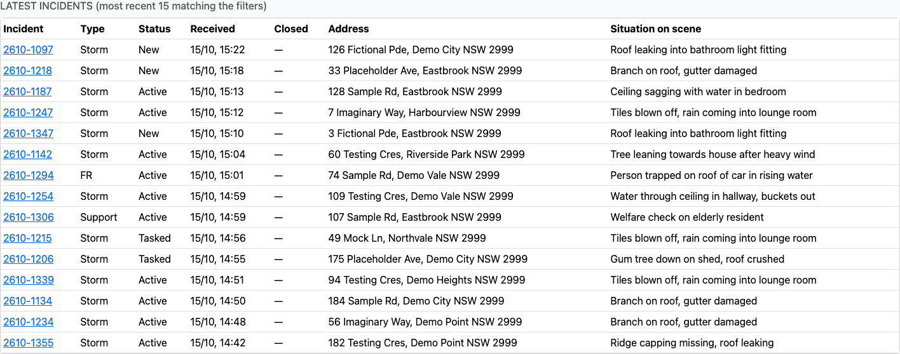

The 15 most recently received incidents that match your filters. Click an incident number to open it in Beacon.

## Situation on Scene

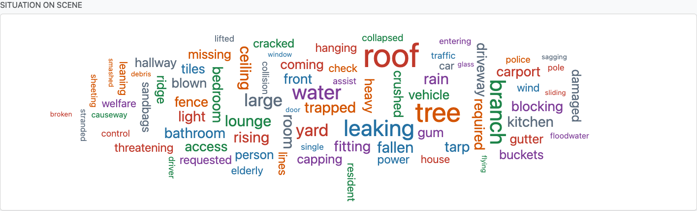

The most common words in the *Situation on Scene* of the incidents that match your filters. Bigger words appear more often. Hover over a word to see how many times it appears. Common words like *the* and *and* are left out.
