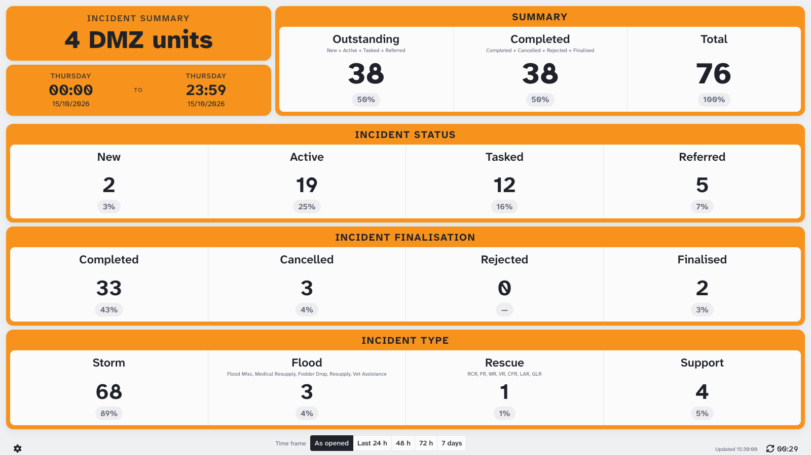
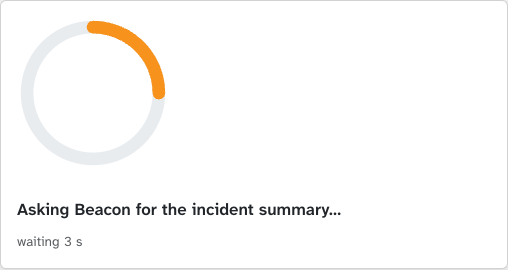
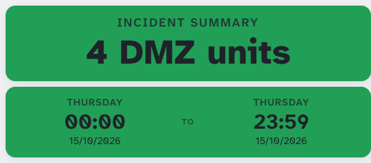
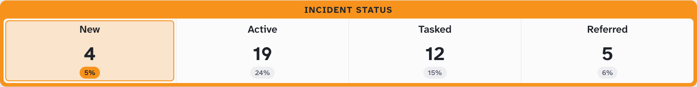
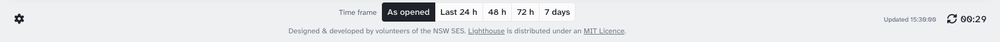
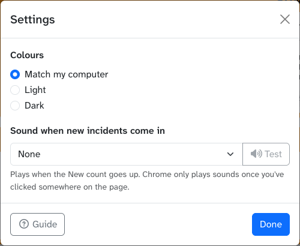
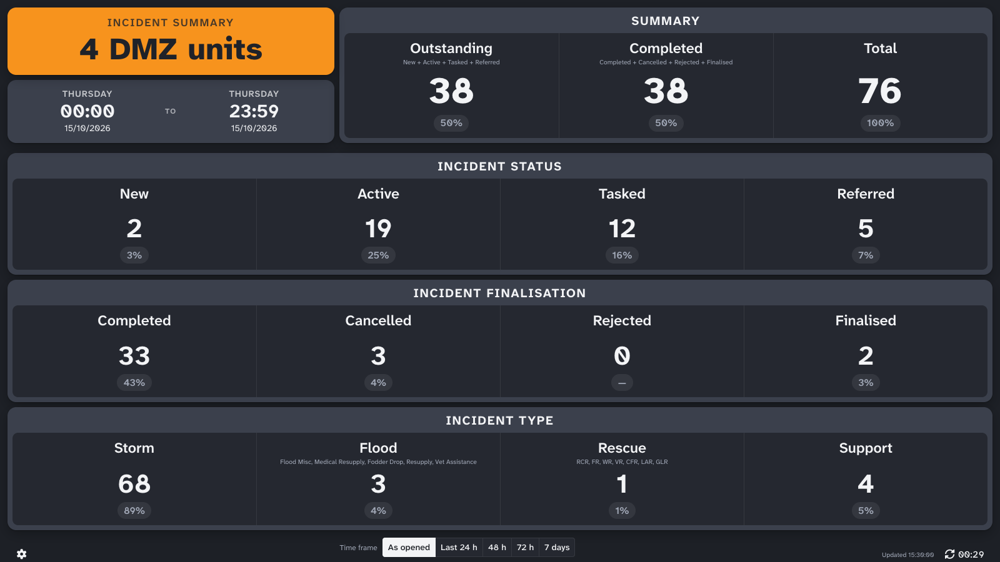

# Incident Summary

Incident Summary shows how many incidents an HQ has, in big numbers that can be read across a room: how many are still open, how many are closed, what state they're in and what kind they are. It's built to be left up on a screen in the HQ. It refreshes itself every 30 seconds and can play a sound when new incidents come in.

> **Note:** Screenshots showing "Demo City" use made-up data.

## Opening Incident Summary

- **From the Lighthouse menu in Beacon:** choose **Incident Summary (*your HQ* Today)**. This opens today's incidents for the HQ you're logged in to.
- **From Beacon's Jobs screen:** filter the incident list as you want it (HQs and dates), then click **Summary (Filtered)** above the list. Incident Summary opens with the same HQs and date range.

If no HQ is selected, the page covers all of NSW.

Beacon usually answers in well under a second. If it takes longer, a ring spins with *Asking Beacon for the incident summary…*. If Beacon hasn't answered after 10 seconds, the page says it's still waiting and offers **Load the last 24 h instead**. If Beacon can't be reached, a message says why, with a **Try again** button. The page also tries again by itself: after 30 seconds, then less often while Beacon keeps failing (up to every 5 minutes), so a screen on the wall recovers without anyone touching it. A *401* error means your Beacon login has expired: open Incident Summary from Beacon again.

## Reading the Page

The box at the top left names the HQs the page covers: the HQ's name (or its code, if the name is long), *N DMZ units* for several HQs in one zone, or *NSW*. Under it is the time range, from the first weekday, time and date to the second.

| Box | Shows |
| --- | --- |
| **Summary** | **Outstanding** (New + Active + Tasked + Referred), **Completed** (Completed + Cancelled + Rejected + Finalised) and the **Total** |
| **Incident Status** | Open incidents by status: **New**, **Active**, **Tasked**, **Referred** |
| **Incident Finalisation** | Closed incidents by outcome: **Completed**, **Cancelled**, **Rejected**, **Finalised** |
| **Incident Type** | **Storm**, **Flood**, **Rescue** and **Support**. Flood and Rescue add up several incident types, listed under the heading. Rescue also counts PAD. |

Each number has its share of the total underneath (e.g. *25%*), or *—* when it's zero.

The boxes are coloured by the Beacon the page was opened from, as in LAD: orange for Beacon, green for Train Beacon and blue for Dev Beacon.

## New Incidents

When a refresh finds more **New** incidents than the last one, the New number lights up for a few seconds, and the page plays the sound you picked in [Settings](#settings).

Chrome only lets a page play sounds once you've clicked somewhere on it, so click the page once after opening it on a wall screen.

## The Footer

| Control | What it does |
| --- | --- |
| Gear (left) | Opens [Settings](#settings). |
| **As opened** / **Last 24 h** / **48 h** / **72 h** / **7 days** | The time range. **As opened** is the range the page was opened with. The others count back from now, and move forward with each refresh. |
| Refresh (right) | Counts down to the next automatic refresh (every 30 seconds). Click it to refresh now. *Updated* shows when the numbers last came in. |

If a refresh fails, a message above the footer says why, with **Try again**. The last numbers stay on screen, with their own dates, and the page keeps trying on its own (see [Opening Incident Summary](#opening-incident-summary)). If changing the time range fails, the range buttons go back to the range on screen.

## Settings

- **Colours:** **Match my computer** (the default) follows your computer's light or dark mode. **Light** and **Dark** keep the page one way. If you picked a theme on the old Job Summary page, it carries over: *Black on orange* is Light, *White on black* and *Night mode* are Dark.
- **Sound when new incidents come in:** *None*, *Chime*, *Phone*, *Minion* or *Ding*. Picking one plays it, and **Test** plays it again.
- **Guide** opens this guide.

Your choices are saved in your browser.

