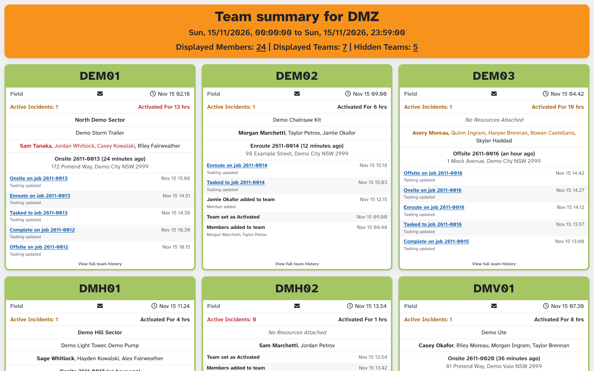
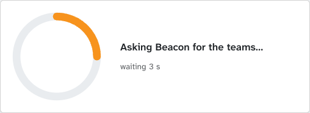
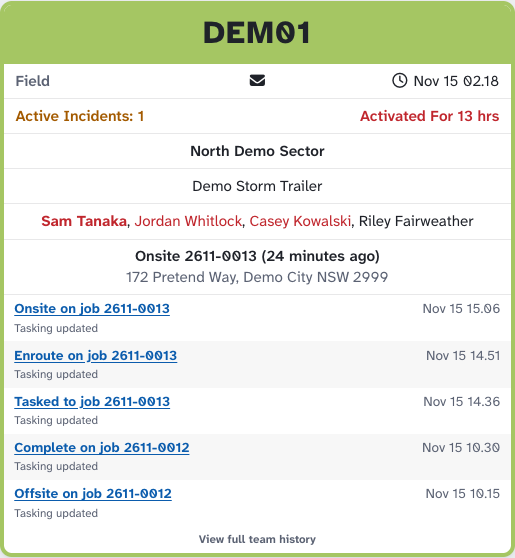
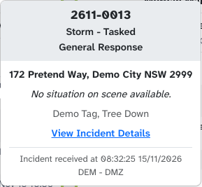
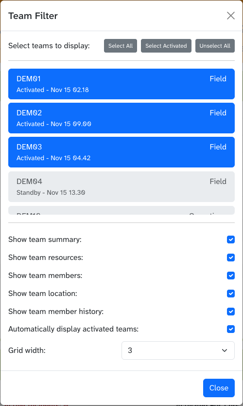
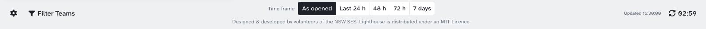
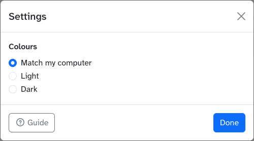
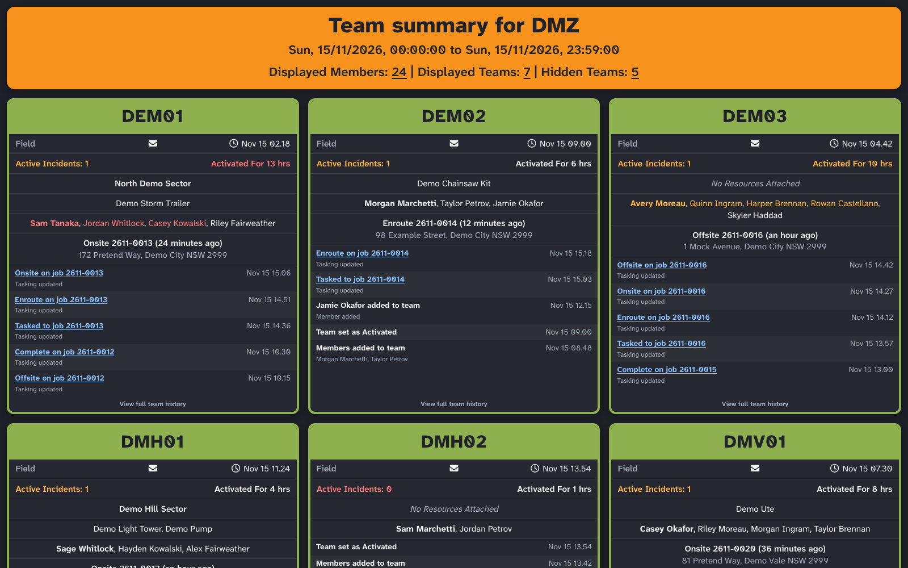

# Team Summary

Team Summary shows a card for each team in an HQ: its status, who's on it, what it's carrying, where it was last seen and what it's done recently. The cards are large enough to read across a room, so the page can be left up on a screen in the HQ. It refreshes itself every 3 minutes.

> **Note:** Screenshots showing "Demo City" use made-up data.

## Opening Team Summary

- **From the Lighthouse menu in Beacon:** choose **Team Summary (*your HQ* Today)**. This opens today's teams for the HQ you're logged in to.
- **From Beacon's Teams screen:** filter the team list the way you want it (HQs and dates), then click **Summary Screen** above the list. Team Summary opens with the same HQs and date range.

If no HQ is selected, the page covers all of NSW.

Once the teams have loaded, the [Team Filter](#choosing-teams) opens so you can pick which teams to show. The activated field teams are already ticked: click **Close** to keep them.

Beacon usually answers within a second. If it takes longer, a ring spins with *Asking Beacon for the teams…*. If Beacon still hasn't answered after 10 seconds, the page says it's still waiting and offers **Load the last 24 h instead**. If Beacon can't be reached, a message says why, with a **Try again** button. The page also tries again by itself: after 30 seconds, then less often while Beacon keeps failing (up to every 5 minutes), so a screen on the wall recovers without anyone touching it. A *401* error means your Beacon login has expired: open Team Summary from Beacon again.

## The Heading

The heading names the HQs the page covers: *Team summary for* the HQ's name, the zone's code when all the HQs are in one zone (e.g. *DMZ*), *N units* for HQs in different zones, or *NSW*. Under it is the time range, then the **Displayed Members**, **Displayed Teams** and **Hidden Teams**. Click the counts to open the [Team Filter](#choosing-teams).

The heading is coloured by the Beacon the page was opened from, as in LAD: orange for Beacon, green for Train Beacon and blue for Dev Beacon.

## Reading a Team

The callsign is at the top, in the team's status colour: green for **Activated**, and greys for **On Alert**, **Standby** and **Rest**. Click the callsign to open the team in Beacon.

From the top down, a card shows:

| Row | Shows |
| --- | --- |
| Type, envelope, clock | The team type (*Field*, *Operations*, …). The envelope opens Beacon's new message screen with the team's members filled in; it's greyed out for a team with no members. The clock shows when the team's status last changed. |
| Team summary | **Active Incidents**: how many incidents the team is tasked to. On the right, how long it has had its status (e.g. *Activated For 6 hrs*). |
| Sector | The team's sector, if it has one. |
| Resources | The resources attached to the team, or *No Resources Attached*. |
| Members | The team's members, or *No Team Members Attached*. The team leader is in bold. Hover over a name to see how long they've been on the team. |
| Location | The team's latest move on an incident (*Enroute*, *Onsite*, *Offsite* or *Complete*), how long ago, and the incident's address. |
| History | The team's latest five history entries from Beacon, newest first. Members added or removed at the same time are rolled into one entry. |

**View full team history** at the bottom opens the team's whole history in Beacon.

Some numbers change colour to catch your eye:

| | Amber | Red |
| --- | --- | --- |
| **Active Incidents** | 1 | 0 (free to task) |
| **Status time** and **members** | On for 10 to 12 hours | On for more than 12 hours |

Red text pulses gently, unless your computer is set to reduce motion.

The team summary, resources, members and location rows can be turned off in the [Team Filter](#choosing-teams).

### Incidents in the History

History entries about an incident (e.g. *Onsite on job 2611-0013*) are links. Click one to see the incident: its number, type and status, priority, address, situation on scene, tags, when it was received and its HQ. **View Incident Details** opens the incident in Beacon. Click anywhere else, or press Esc, to close it.

The heading of the box is coloured by priority: red for Rescue, orange for Priority Response, blue for Immediate Response.

## Choosing Teams

The **Team Filter** opens by itself once the teams have loaded. Open it again with the counts in the heading or **Filter Teams** in the footer.

Under **Select teams to display**, click a team to show it (highlighted) or hide it (grey). **Select All** shows every team, **Select Activated** shows only the activated teams (of any type), and **Unselect All** hides them all. The cards change as you click, so you can watch the screen behind the box.

Under the list:

- **Show team summary**, **Show team resources**, **Show team members**, **Show team location:** turn those rows of every card on or off.
- **Show team member history:** include members added to and removed from the team in each card's history.
- **Automatically display activated teams:** when a team is activated, it's added to the screen at the next refresh, whatever its type. Turn this off to show only the teams you pick. Teams you hide stay hidden until you show them again, or until they're activated again.
- **Grid width:** 2, 3 or 4 teams side by side. A narrow window shows fewer: 2 on a small laptop or tablet, 1 on a phone.

These choices, except which teams are shown, are saved in your browser.

Beacon's search covers teams that are On Alert, on Standby, Activated or on Rest. Stood-down teams aren't listed.

## The Footer

| Control | What it does |
| --- | --- |
| Gear | Opens [Settings](#settings). |
| **Filter Teams** | Opens the [Team Filter](#choosing-teams). |
| **As opened** / **Last 24 h** / **48 h** / **72 h** / **7 days** | The time range for Beacon's team search. **As opened** is the range the page was opened with. The others count back from now, and move forward with each refresh. |
| Refresh (right) | Counts down to the next automatic refresh (every 3 minutes). Click it to refresh now. *Updated* shows when the teams last came in. |

Each refresh also reloads the history of every team on screen. The Team Filter only opens by itself the first time. If a team's history can't be loaded, its card says so and the rest of the page carries on.

If a refresh fails, a message above the footer says why, with **Try again**. The cards on screen stay up, and the page keeps trying on its own (see [Opening Team Summary](#opening-team-summary)). If changing the time range fails, the range buttons go back to the range on screen.

## Settings

The gear in the footer opens Settings.

- **Colours:** **Match my computer** (the default) follows your computer's light or dark mode. **Light** and **Dark** keep the page one way. Saved in your browser.
- **Guide** opens this guide.

